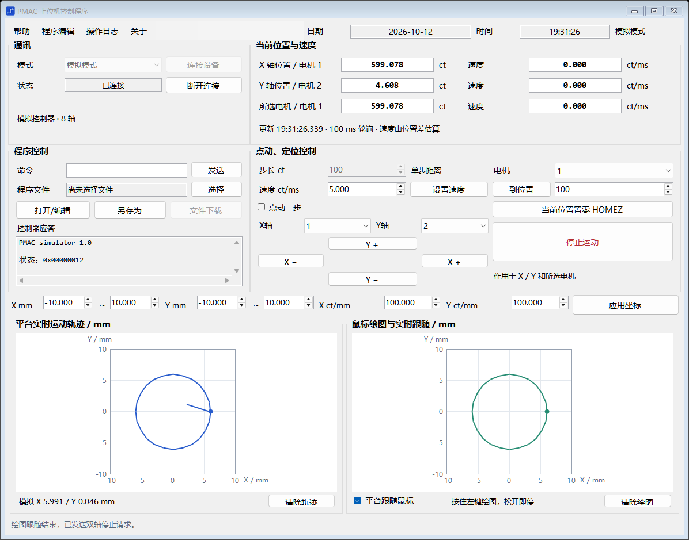

# Operation and Control

PMAC 运动控制学习资料与 C# WinForms 上位机项目。上位机面向 Turbo PMAC，使用 .NET Framework 3.5 / x86，提供模拟模式与 PcommServer 实机通信接口。

在一个主窗口内完成 **绘图或 DXF 导入 → PVT / SPLINE1 规划 → 程序预览 → 运行与反馈采集 → 轨迹分析和数据导出**，同时支持手动控制、程序编辑、坐标设置和日志查看。



## 功能

| 页面 | 主要功能 |
| --- | --- |
| 绘图与运行 | 自由绘图、直线、圆、圆弧、五角星；DXF 导入；PVT / SPLINE1 路径规划与双轴运行；左侧显示实际轨迹，右侧显示输入图形 |
| 手动控制 | 电机选择、点动、定位、速度设置、位置反馈和当前位置置零 HOMEZ |
| 程序 | 预览和保存规划程序，编辑、保存、下载自定义程序，发送单条命令 |
| 分析 | 时间配对误差、轮廓 RMS / 最大偏差、跟随滞后估计和通信采样统计 |
| 设置 | X/Y 坐标比例、行程、图形变换、程序参数、使能 / 失能、机械回零 |
| 日志 | 查看、清空和导出操作记录 |

顶部显示连接状态、X/Y 位置和全局“停止”；Esc 也可停止。运行期间锁定相关参数和手动命令，关闭程序会先请求停止。

DXF 支持 ASCII 格式的 LINE、ARC、CIRCLE、LWPOLYLINE（含圆弧段）、二维 POLYLINE 和非周期控制点 SPLINE。DWG 需先转换为 ASCII DXF；不支持的实体会明确报错。多笔画之间包含定位转移，当前没有抬笔或刀具开关控制。

## 编译与运行

环境：Windows、.NET Framework 3.5，以及 Visual Studio 的 .NET 桌面开发工具或可用的 MSBuild。模拟模式无需安装 PMAC 驱动。

在仓库根目录打开 PowerShell，执行：

```powershell
# Release 编译
.\online\build.ps1

# 启动程序
& '.\online\Operations Control\bin\Release\Operations Control.exe'
```

也可在 Visual Studio 中打开 `online/Operations Control/Operations Control.csproj`。`bin`、`obj` 为本地生成目录，不随源码提交，需要先编译再启动。

### 模拟演示

1. 保持模拟模式，点击“连接”。
2. 在“绘图与运行”页导入 [course-shapes.dxf](online/examples/course-shapes.dxf)，或添加图形、自由绘图。
3. 选择 PVT 或 Spline1，设置速度、加速度和点间距，点击“生成规划”。
4. 在“程序”页查看规划程序，再点击“运行”，观察左侧反馈轨迹和顶部位置。
5. 运行结束后进入“分析”页，点击“分析”与“导出数据”。可导出原始绘图点、规划段、实际反馈及误差 CSV、分析报告和 PMAC 程序。

模拟默认使用 X/Y 电机 1/2、100 ct/mm、各轴行程 ±10 mm、80 ms 跟随滞后。这些值用于演示，实机参数需另行标定。

绘图本身不会启动运动；勾选“鼠标跟随”后，按住左键可跟随，松开、失焦或移出画布即停。鼠标跟随通过独立轴目标更新执行，完整路径运行使用坐标系插补。

## 验证

在仓库根目录执行：

```powershell
# 编译并运行模拟检查，截图写入系统临时目录
.\online\build.ps1 -Configuration Release -Test -ScreenshotDirectory "$env:TEMP\pmac-verification"

# Debug 编译
.\online\build.ps1 -Configuration Debug
```

最近一次验证（2026-10-13）：Release 编译通过，**130 项基础检查与 2273 项工作流断言通过**，覆盖 DXF、规划约束、主窗口交互、完整模拟运行、数据导出、停止和回零流程。检查均使用模拟器；断言数量包含逐段轨迹检查，不代表功能数量。

## 实机使用

实机模式需要安装并配置 32 位 PcommServer / PMAC 驱动，通过厂家配置工具设置设备与通信参数，再在程序中选择设备。当前通信使用 PcommServer COM，界面没有直接配置 IP 或 Socket 连接的功能。

软件与模拟验证已完成，实机通信、ct/mm 标定、轴方向与行程、机械回零 / PLC、固件程序执行和真实精度仍待现场验收。模拟器执行数学规划，不解释任意下载脚本或用户 PLC；HOMEZ 仅将当前位置设零。软件停止通过通信队列发送，不能替代硬件急停。参数和验收步骤见 [操作与验收](online/docs/工艺工作台使用与验收.md)。

## 目录与文档

| 路径 | 内容 |
| --- | --- |
| [online](online/README.md) | 上位机源码、编译脚本、DXF 样例、界面截图与操作说明 |
| [docs](docs/README.md) | 学习路线、第三组分工表、实施计划和第一周答辩资料 |
| [pmac资料](pmac资料/) | 用户 / 编程 / 硬件手册、通信与调试教程、伺服驱动资料和培训 PPT |
| [答辩 PDF](output/pdf/第一周答辩_剩余问题与参考答案.pdf) | 第一周答辩问题与参考答案的 PDF 版本 |

- 入门：[PMAC 零基础学习路线](docs/PMAC零基础最快学习路线.md)、[C# 上位机学习路线](docs/PMAC上位机学习路线.md)。
- 操作：[工艺工作台使用与验收](online/docs/工艺工作台使用与验收.md)、[DXF 样例](online/examples/course-shapes.dxf)。
- 实现：[代码功能说明](online/docs/代码功能说明.md)、[软件开发问题与解决记录](online/docs/软件开发问题与解决记录.md)。
- 进度：[上位机任务完成情况](online/docs/上位机任务完成情况.md)、[分工表标注副本](docs/第三组分工表_上位机完成情况.xlsx)。

## 参考与许可

上位机的界面参考 [lin-tea/PMAC_CSharp](https://github.com/lin-tea/PMAC_CSharp)。

项目采用 [MIT License](LICENSE)。收录的第三方手册、安装包及参考素材，其权利归各自原作者所有。
