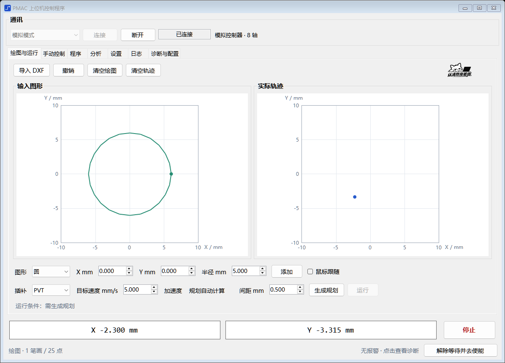

# Operation and Control

PMAC 运动控制学习资料与 C# WinForms 上位机项目。上位机面向 Turbo PMAC，使用 .NET Framework 3.5 / x86，提供模拟模式与 PcommServer 实机通信接口。

在一个主窗口内完成 **绘图或 DXF 导入 → PVT / SPLINE1 规划 → 程序预览 → 运行与反馈采集 → 轨迹分析和数据导出**，同时支持手动控制、程序编辑、坐标设置和日志查看。



## 功能

| 页面 | 主要功能 |
| --- | --- |
| 绘图与运行 | 自由绘图、直线、圆、圆弧、五角星；DXF 导入；PVT / SPLINE1 路径规划与双轴运行；左上方显示输入图形，右侧显示实际轨迹 |
| 手动控制 | 电机选择、点动、定位、速度设置、位置反馈和当前位置置零 HOMEZ |
| 程序 | 预览和保存规划程序，编辑、保存、下载自定义程序，发送单条命令 |
| 分析 | 时间配对误差、轮廓 RMS / 最大偏差、跟随滞后估计和通信采样统计 |
| 设置 | X/Y 坐标比例、行程、图形变换、程序参数、使能 / 失能、机械回零 |
| 日志 | 查看、清空和导出操作记录 |
| 诊断与配置 | 每轴状态与跟随误差趋势、当前/历史报警、设备配置和 I/O 查询；手动运动带行程检查、到位及停稳确认 |

顶部通讯区始终显示连接模式和状态，底部始终显示 X/Y 位置、全局“停止”和报警；Esc 也可停止。导入、撤销、绘图参数、规划和运行工具集中在“绘图与运行”页，切换其他页面后隐藏。手动控制保留独立的“所选轴使能”和“所选轴去使能”按钮。状态用颜色和文字区分：绿色表示就绪，蓝色表示处理中，黄色表示反馈未知或条件不足，红色表示故障与限位；无报警使用中性色。运行期间锁定相关参数和手动命令，关闭程序会先请求停止并等待反馈确认。

DXF 支持 ASCII 格式的 LINE、ARC、CIRCLE、LWPOLYLINE（含圆弧段）、二维 POLYLINE 和非周期控制点 SPLINE。DWG 需先转换为 ASCII DXF；不支持的实体会明确报错。多笔画之间包含定位转移，当前没有抬笔或刀具开关控制。

## 编译与运行

环境：Windows、.NET Framework 3.5，以及 Visual Studio 的 .NET 桌面开发工具或可用的 MSBuild。模拟模式无需安装 PMAC 驱动。

在仓库根目录打开 PowerShell，执行：

```powershell
# Release 编译
.\scripts\build.ps1

# 启动程序
& '.\src\Operations Control\bin\Release\Operations Control.exe'
```

也可在 Visual Studio 中打开 `src/Operations Control/Operations Control.csproj`。`bin`、`obj` 为本地生成目录，不随源码提交；本地已有的 Debug / Release 构建继续保留在 `bin/` 下。

### 模拟演示

1. 保持模拟模式，点击“连接”。
2. 在“绘图与运行”页导入 [course-shapes.dxf](examples/course-shapes.dxf)，或添加图形、自由绘图。
3. 选择 PVT 或 Spline1，设置目标速度和点间距，点击“生成规划”。PVT 默认启用连续模式，首尾相接的笔画会合并；需要每条笔画独立停机时取消“连续 PVT”。加速度由规划器根据路径几何自动计算。
4. 在“程序”页查看规划程序，再点击“运行”，观察右侧反馈轨迹和下方位置。
5. 运行结束后进入“分析”页，点击“分析”与“导出数据”。可导出原始绘图点、规划段、实际反馈及误差 CSV、分析报告和 PMAC 程序。

模拟默认使用 X/Y 电机 1/2、100 ct/mm、各轴行程 ±10 mm、100 ms 鼠标随动整理缓冲。这些值用于演示，实机参数需另行标定。

绘图本身不会启动运动；左侧绘图区的橙色实线十字持续显示当前下位机位置。选择“PVT / Spline1”并勾选“鼠标跟随”后，十字周围出现可抓取的浅橙色区域（标准 DPI 下半径 18 像素），悬停时显示手形光标。按住该区域拖动即可随动：按下时自动吸附到当前反馈位置，拖动时保持抓取偏移，虚线十字显示目标，实线十字继续显示真实反馈；松开后可直接重新抓取当前位置继续画，无须反复取消再启用。区域外起笔仍需满足原有 0.5 mm 起点检查。若要改用远处起点，先取消随动并用点动/定位移动平台。随动先用 100 ms 缓冲整理输入，在 60 ms 时间窗口内合并输入折线偏差不超过 0.02 mm 的冗余点，保留转角、反向及终点；PVT 按速度限制分段，Spline1 用固定 60 ms 的 TM 追加新控制点。控制器队列接近上限时，界面显示“缓冲等待”，保留待发送片段并自动继续；实际滞后取决于通信和运动速度。松开、失焦、移出画布或拖动目标超出范围会中止随动并停止两轴。完整路径运行仍使用坐标系 PVT/SPLINE1 程序。

## 验证

在仓库根目录执行：

```powershell
# 编译并运行模拟检查，截图写入系统临时目录
.\scripts\build.ps1 -Configuration Release -Test -ScreenshotDirectory "$env:TEMP\pmac-verification"

# Debug 编译
.\scripts\build.ps1 -Configuration Debug
```

最近一次验证（2026-10-29）：Debug 编译及模拟检查通过，**149 项基础断言、2287 项工作流断言、136 项模块断言和 124 项电机调试断言通过**，覆盖 DXF、规划约束、完整模拟运行、每轴状态、到位/停稳、通信无响应、配置与日志。检查均使用模拟器或假设备；断言数量包含逐段轨迹检查，不代表功能数量。

## 实机使用

实机模式需要安装并配置 32 位 PcommServer / PMAC 驱动，通过厂家配置工具设置设备与通信参数，再在程序中选择设备。当前通信使用 PcommServer COM，界面没有直接配置 IP 或 Socket 连接的功能。

实机鼠标随动通过预留坐标系的旋转程序缓冲区（ROT）持续追加 PVT / Spline1；首次使用时申请 2048 字缓冲区。不会自动删除现有 ROT/LOOKAHEAD/GATHER 资源。`PVT 20` 返回 `ERR005` 的原因及修复流程见 [实时随动 ERR005 修复说明](docs/software/实时随动ERR005修复说明.md)。

鼠标随动速度由轨迹自动计算：依据坐标换算后的距离和鼠标时间戳，画快则提高参考速度，画慢则降低。此时“目标速度 mm/s”仅用于完整路径规划，“手动控制”的点动速度也不参与随动计算。界面显示“画速 / 参考速度”，超过任一轴配置上限时显示“轴上限限速”，放慢执行并保留轨迹顺序。X/Y 分别按自己的 ct/mm 换算上限；PVT 保留段时间，Spline1 将其量化到固定 60 ms 的段时间，通信和缓冲也会带来滞后。实机反馈速度和精度需现场核验。松开鼠标仍停止并取消未执行轨迹。

软件与模拟验证已完成，实机通信、ct/mm 标定、轴方向与行程、机械回零 / PLC、固件程序执行和真实精度仍待现场验收。模拟器执行数学规划，不解释任意下载脚本或用户 PLC；HOMEZ 仅将当前位置设零。软件停止通过通信队列发送，不能替代硬件急停。参数和验收步骤见 [操作与验收](docs/software/工艺工作台使用与验收.md)。

## 目录与文档

| 路径 | 内容 |
| --- | --- |
| [src](src/Operations%20Control/) | 上位机源码与 Visual Studio 工程 |
| [tests](tests/) | 独立的模拟、工作流、模块和电机调试检查 |
| [scripts](scripts/) | Release / Debug 构建与模拟验证脚本 |
| [docs](docs/README.md) | 学习路线、第三组分工表、实施计划和第一周答辩资料 |
| [examples](examples/) | DXF 与 CAD 文件样例 |
| [assets](assets/) | 上位机截图和界面证据 |
| [demos](demos/) | 上下位机绘图复现动画演示 |
| [references/pmac](references/pmac/) | 用户 / 编程 / 硬件手册、通信与调试教程、伺服驱动资料和培训 PPT |
| [reports](reports/) | 按周整理的课程报告与汇报材料 |
| [artifacts/output](artifacts/output/) | 答辩 PDF、生成材料和验证结果 |
| [artifacts/archive](artifacts/archive/) | 原有研究记录、临时验证输出和归档压缩包 |

`src/Operations Control/bin/` 当前只保留 `Debug` 和 `Release` 两个本地版本；其他历史构建目录已清理。`bin`、`obj`、`.vs` 和 `.local` 不纳入 Git 提交。构建结果需要时可通过仓库根目录的 `scripts/build.ps1` 重新生成。

- 入门：[PMAC 零基础学习路线](docs/PMAC零基础最快学习路线.md)、[C# 上位机学习路线](docs/PMAC上位机学习路线.md)。
- 操作：[工艺工作台使用与验收](docs/software/工艺工作台使用与验收.md)、[DXF 样例](examples/course-shapes.dxf)。
- 电机调试：[保护、诊断和配置说明](docs/software/电机调试与保护说明.md)。
- 实现：[代码功能说明](docs/software/代码功能说明.md)、[软件开发问题与解决记录](docs/software/软件开发问题与解决记录.md)。
- 进度：[上位机任务完成情况](docs/software/上位机任务完成情况.md)、[分工表标注副本](docs/第三组分工表_上位机完成情况.xlsx)。

## 参考与许可

上位机的界面参考 [lin-tea/PMAC_CSharp](https://github.com/lin-tea/PMAC_CSharp)。

项目采用 [MIT License](LICENSE)。收录的第三方手册、安装包及参考素材，其权利归各自原作者所有。
