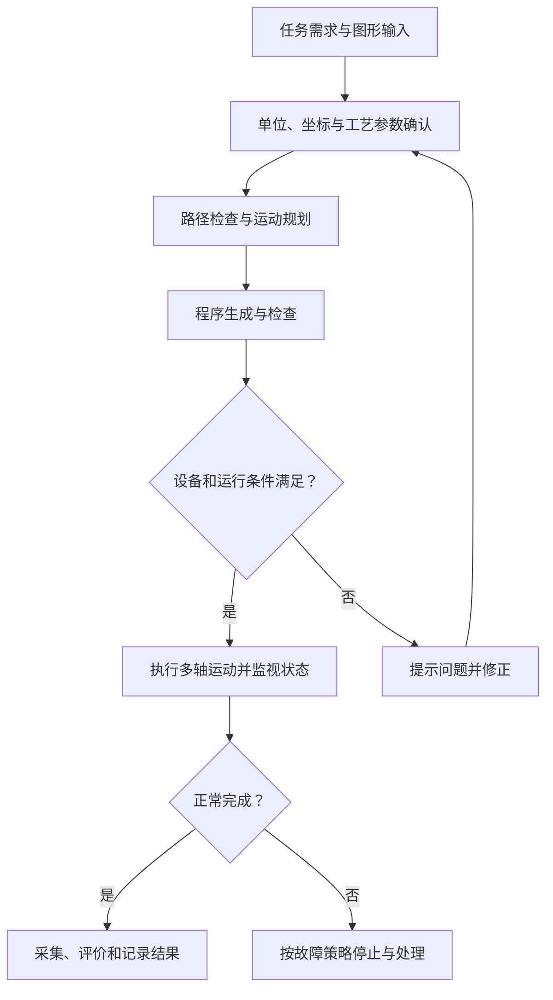

# 第一周答辩：剩余问题与参考答案

整理日期：2026-10-13。

本文件依据《运行与控制 - 1批-实施计划》PDF 第 9–11 页的第一阶段量规，以及第三组分工表的“第一周任务”，整理为 63 道可能的主问题和追问。问题编号从 Q03 开始，覆盖第一周全部评分点，便于零基础理解和口头练习。

此前已经讲解的两道主问题不再重复收录：Q01“上位机、PMAC、驱动器、电机、编码器的职责与指令、反馈链路”；Q02“PMAC 的 PLC 程序与运动程序的区别及运行方式”。相关评分点仍安排了更具体的追问。

每题的“参考回答”可作为口头答辩的基础。“理解与补充”解释容易混淆的概念。“需补事实”表示必须结合实际设备、测试或本人工作填写的内容。文中的教学假设、建议方案和回答模板，均不代表已经完成的现场工作。

当前资料围绕 Turbo PMAC/Clipper，实际控制器、驱动器、轴比例、行程和反馈接线尚待核对。上位机现有说明记录了软件与模拟成果；本文件未重新运行软件检查，也没有验证实机。后续阶段的完整回零编程、PVT/Spline 编程、CAD 文件解析和轨迹精度分析不作为第一周的核心考题。

## 评分点与题号索引

下表分值是各 ILO 第一阶段量规内部的分值，不能直接相加作为课程总分。

| ILO | 第一周评分点 | 分值 | 对应问题 |
| --- | --- | --- | --- |
| ILO1 | 团队目标、组长职责、成员相互了解 | 30 | Q03–Q06 |
| ILO1 | 成员管理、任务管理、具体分工和工作计划 | 50 | Q06–Q09 |
| ILO1 | Ego 云任务安排截图 | 20 | Q10 |
| ILO2 | XY 平台系统架构与完整接线展示 | 30 | Q12–Q16、Q19–Q20 |
| ILO2 | PMAC 体系结构、组成逻辑和外围接口 | 30 | Q11–Q12、Q17–Q18 |
| ILO2 | PLC 概念、运行方式和程序跑通 | 40 | Q21–Q22，另见已讲解的 Q02 |
| ILO3 | 上位机功能、交互概念和设计方法 | 30 | Q23–Q25、Q31–Q32、Q37 |
| ILO3 | 通信机制、编程方法和控制下位机的方法 | 30 | Q26–Q30、Q33 |
| ILO3 | 功能需求、定位精度和运动规划要求 | 40 | Q34–Q36、Q38 |
| ILO4 | 多轴联动原理与工艺流程图 | 30 | Q39–Q41 |
| ILO4 | UG NX 仿真原理与核心通信机制 | 30 | Q42–Q44 |
| ILO4 | UG NX 安装与应用 | 40 | Q45 |
| ILO5 | NX-MCD 多轴平台与数字孪生设计思路 | 30 | Q43、Q46、Q50 |
| ILO5 | 关键零件工程图国家标准 | 30 | Q51–Q52 |
| ILO5 | 零件及整机的 XY 平台三维模型 | 40 | Q47–Q49、Q53 |
| ILO6 | 表述、分析问题，提出方案并评价效果 | 40 | Q57–Q60 |
| ILO6 | 开闭环概念及本系统控制类型 | 60 | Q54–Q56 |
| ILO7 | 按量规顺序、规范制作周报 | 20 | Q61 |
| ILO7 | 面向听众、有效回答、10 分钟内汇报 | 60 | Q62、Q64–Q65 |
| ILO7 | 小组资料与每位成员工作汇报按时提交 | 20 | Q63 |

## 一、团队目标、分工与管理：ILO1

### Q03 你们团队的项目目标是什么？第一周要交付什么？

**参考回答：**

项目的总体目标是围绕 XY 运动平台，完成基于 PMAC 的运动控制，并结合上位机和 NX-MCD 建立控制、建模与仿真流程。第一周的重点是建立团队和工作计划，认识系统架构，展示接线，解释 PMAC 与上位机通信原理，明确需求，并形成平台零件和整机模型及规范周报。

**理解与补充：**

目标应写成可检查的成果，例如“提交架构图和接线表”“展示通信查询结果”“提交平台模型”。“学习 PMAC”“熟悉软件”只能说明活动，不能说明完成标准。第一周目标还应与后续阶段的完整联动和精度验收区分。

**需补事实：**本组实际确定的最终应用、第一周已完成成果和待完成事项。

### Q04 你们如何分组？各小组之间怎样配合？

**参考回答：**

第三组分工表列有电控组、建模组和仿真组。电控组包括江明晖、陈帝谷、黄元河；建模组包括郑健豪、邓伟业、陈昱名；仿真组包括林涣捷、毛振华、邱宇航。电控组承担控制系统、通信和上位机相关任务；建模组承担零件与平台建模及工程图；仿真组承担仿真原理和环境相关任务。各组需要统一轴方向、单位、机械参数和信号含义，才能把成果接起来。

**理解与补充：**

这里的成员与任务归属来自分工表，不代表每个人已经完成了对应工作。模型里的正 X 方向、控制器的正向移动、上位机的坐标方向必须一致；一个组修改了导程或零点，其他组也要同步。

**需补事实：**每位成员的具体交付物、协作记录和接口负责人。

### Q05 谁是组长？组长的职责是什么？

**参考回答模板：**

我们通过【实际选拔方式】确定【姓名】担任组长。组长负责分解目标、协调人员和接口、检查进度、组织会议、汇总问题和材料，并推动未完成事项按计划闭环。技术工作由具体负责人承担，组长负责协调和跟踪。

**理解与补充：**

分工表把第一周团队建设、规范和任务截图条目分配给江明晖，但仅凭这一点不能确定其正式组长身份。回答应说明实际选拔方式和职责，并能展示分工或会议记录。

**需补事实：**组长姓名、选拔方式及实际承担的协调工作。

### Q06 你个人负责什么？怎样判断任务完成？

**参考回答模板：**

我负责【具体任务】，输入是【需要的设备参数或其他成员成果】，输出是【代码、接线表、模型、说明或测试记录】。计划在【时间】完成，验收方式是【演示、检查或测试方法】。目前已经完成【有证据的部分】，尚缺【待完成部分】，由【相关人员】协助确认。

**理解与补充：**

“我负责上位机”太宽泛。可以细化为“设备连接和断开”“位置读取与单位换算”“需求说明”等。能讲清输入、输出、时间和验收方法，才算具体分工。

### Q07 你们的成员管理和任务管理办法是什么？

**参考回答模板：**

成员管理方面，我们约定【会议、出勤、沟通和问题反馈规则】。任务管理方面，每个任务记录负责人、截止时间、交付物和验收标准，并区分待开始、进行中、待验收和已完成。出现阻塞时记录原因、依赖和解决期限；关键修改要通知相关成员。

**理解与补充：**

这是建议的管理结构，是否已经执行要用实际记录证明。只写一份制度不能说明管理有效，应能展示某项任务怎样被跟踪、怎样发现延期，以及怎样调整。

**需补事实：**已采用的规则、任务清单和执行记录。

### Q08 不同小组怎样避免“各做各的，最后无法集成”？

**参考回答：**

我们应先统一接口约定，包括 X/Y 方向、单位、零点、行程、轴号、导程、反馈比例和信号名称。模型、控制程序和上位机都引用同一份参数记录。集成前先验证一个轴，再验证两轴，出现差异时根据接口记录定位问题。

**理解与补充：**

常见问题是模型用米、上位机用毫米，或者仿真“正向”与实际电机方向相反。接口表至少应记录参数名称、含义、单位、提供者、使用者和版本。这里描述的是协作方法，实际是否落实需展示对应记录。

### Q09 你们第一周计划如何安排？遇到延期怎么办？

**参考回答模板：**

我们将第一周任务按依赖排序：先清点设备和资料、确认分工，再完成架构和接线核对，随后验证通信、形成需求和模型，最后统一材料并预演答辩。每项任务都有负责人和完成标准。出现延期时，先找出缺少的输入，再调整资源或缩小当周交付范围，并明确新的期限。

**理解与补充：**

软件、硬件和模型可以并行准备，但实际移动依赖接线、模式、反馈和运动条件确认。调整计划时要说明影响哪些后续任务，不能只把所有截止时间一起往后推。

**需补事实：**本组真实时间表、实际阻塞和调整记录。

### Q10 怎样证明团队建设和任务分配已经完成？

**参考回答：**

第一周量规要求明确团队目标、组长职责、成员管理与任务管理办法、具体分工和工作计划，并提供小组合影及 Ego 云上的小组任务安排截图。我们应展示这些材料，并让截图中的负责人、任务和实际分工一致。

**理解与补充：**

量规对 Ego 云任务安排截图明确写了“无截图 0 分”。本地分工表是组织依据，但不能证明已在平台提交。会议记录可以补充说明协作过程，也不能替代指定截图。

**需补事实：**合影、真实平台截图、任务分配和上传记录。

## 二、PMAC、接线与下位机基础：ILO2

### Q11 PMAC 的体系结构由哪些部分组成？它们怎样协同？

**参考回答：**

PMAC 是可编程多轴运动控制器。从功能上看，它包括运算处理和程序执行、参数与程序存储、运动及伺服控制、指令输出与反馈采集、数字输入输出和上位机通信等部分。它接收上位机要求，执行运动或 PLC 逻辑，生成控制输出，读取反馈和输入状态，并向上位机返回数据。

**理解与补充：**

体系结构要同时讲组成和数据流。不同型号的处理器、可用轴数、接口及扩展能力不同，应依据实机手册补充，不能把某款 PMAC 的规格直接说成所有型号都具备。

**需补事实：**实机型号、可用接口、实际使用轴数及扩展板。

### Q12 PMAC 的外围接口有哪些？本系统实际用到了哪些？

**参考回答：**

应按实机手册识别供电接口、电脑通信接口、运动指令输出接口、编码器反馈接口、使能及报警接口，以及正负限位、原点和其他数字 IO。答辩时要说明本系统具体使用哪些接口，信号方向是什么，连接到哪个部件。

**理解与补充：**

“有 IO 接口”还不够完整。需要说明输入用于读取什么状态、输出用于发出什么要求，以及信号的电气形式。端口名称、针脚、电压、有效极性和接地方式必须按实际型号核对。

**需补事实：**端子号、针脚号、信号形式及完整接线表。

### Q13 接线图应展示哪些线？怎样证明接线正确？

**参考回答：**

接线图应展示电源与保护接地、PMAC 到驱动器的控制信号、使能和报警、驱动器到电机的动力线、编码器反馈，以及限位和原点信号。证明接线正确需要逐项对照型号手册和端子，检查输入状态与实物动作是否一致，再按设备条件验证方向和运动响应。

**理解与补充：**

架构图说明部件关系，接线表说明“哪个端子接哪个端子”。两者都需要。线色和其他设备的教程不能替代本机端子定义；资料中的接线实例也不能直接当成本组实机接线。

### Q14 脉冲加方向和模拟量控制有什么区别？

**参考回答：**

脉冲加方向方式用脉冲数量表达位置增量，用脉冲频率表达运动速率，用方向信号表达正反方向；驱动器按其配置解释输入。模拟量方式用电压等连续信号表达控制要求，具体是速度还是转矩等，取决于驱动器工作模式。接口方式会影响 PMAC 输出设置、驱动参数和闭环结构。

**理解与补充：**

脉冲控制也可以使用伺服电机。教程中某些设置选择 stepper，可能是在选择脉冲输出接口，并不能据此认定实际电机是步进电机。实际控制方式要同时核对信号接线和驱动器模式。

### Q15 为什么运动的实时控制主要放在 PMAC 中，而不是靠电脑定时器？

**参考回答：**

运动需要持续、协调地更新目标和控制输出。PMAC 的运动与伺服任务在控制器内部按其时钟和配置运行；Windows 上位机的定时器会受线程调度、通信和界面负载影响。因此上位机负责交互、下发要求和显示状态，实时插补与轴控制由 PMAC 执行。

**理解与补充：**

把界面刷新间隔设置得更小，不会自动提高伺服控制频率。实际伺服环路位于 PMAC 还是驱动器，还要依据控制方式判断；两者都不应靠界面轮询来替代。

### Q16 怎样确认编码器反馈方向、数值和来源正确？

**参考回答：**

首先确认编码器反馈接到哪里，以及 PMAC 读取的计数来自真实编码器还是内部指令计数。随后在设备允许的条件下，用已知方向和位移检查计数方向及变化量，并与驱动器显示和机械实测交叉核对。闭环运行前，指令方向和反馈方向必须匹配。

**理解与补充：**

真实位置反馈与发送出去的指令计数是两类信息。只看到 Position 窗口中的数值变化，不能证明机械位移正确。反馈分辨率和机械传动比例也需要记录。

**需补事实：**反馈来源、方向验证和位移对照记录。

### Q17 电机号、坐标轴和坐标系有什么区别？

**参考回答：**

电机号选择具体控制轴，例如 `#1` 选择电机 1；X、Y 是运动程序使用的坐标轴名称；坐标系把需要协调运动的轴组织起来，例如 `&1` 选择坐标系 1。需要通过轴定义建立电机与坐标轴之间的映射，并设置机械单位对应的计数比例。

**理解与补充：**

例如 `#1->100X` 表达电机 1 对 X 轴的映射与比例，100 是该定义中的示例比例。它不代表本组实机的比例。两个电机加入同一坐标系，是协调运动配置的一部分，但还需要正确程序、单位和运动条件。

### Q18 I、P、M 变量分别是什么？为什么不能只凭编号判断用途？

**参考回答：**

I 变量主要用于控制器和电机的配置参数；P 变量可以保存程序数据、步骤和状态；M 变量可以映射到寄存器、状态位或其他数据。M 变量的具体含义取决于其定义，P 变量的业务含义取决于程序怎样使用，不能只看编号就认定用途。

**理解与补充：**

当前教程中 P801 被用作回零步骤变量，但它不是 PMAC 统一规定的回零状态。Turbo PMAC 的 I122 是电机 1 点动速度，I123 是回零速度及方向；具体含义与单位应查对应软件参考手册。

### Q19 第一次上机，你会按什么顺序检查？

**参考回答：**

先记录设备型号、控制方式和接线，备份控制器与驱动器参数，再建立通信并读取状态。随后检查报警、使能、反馈方向、限位和原点输入，并确认机械固定、允许行程和停止条件。相关条件确认后，再从低速短距离的单轴动作开始验证。

**理解与补充：**

建立通信只是调试中的一步。备份应包含参数、运动程序、PLC 程序和 M 变量定义，并标注日期、设备和轴号，便于恢复到已知状态。

### Q20 什么是使能？为什么使能后电机不一定运动？

**参考回答：**

使能表示允许相应驱动器或控制轴工作，不等于已经给出运动目标。轴可能使能但保持当前位置。要运动，还需满足报警、限位、驱动模式、闭环配置等条件，并接收到有效运动要求。诊断时应分别检查驱动器状态、PMAC 轴状态和运动命令。

**理解与补充：**

驱动器使能和 PMAC 轴的控制状态是相关但不同的状态，具体关系依赖接线和配置。也不能把通信打开成功当成使能成功。

### Q21 老师让你现场证明“PLC 程序跑通了”，你应该展示什么？

**参考回答：**

我应展示程序的用途、步骤和条件，说明它在哪个 PLC 缓冲区、怎样使能和停止，再观察一个可核对的输入或条件如何引起状态变化，以及程序怎样结束或处理异常。上传和下载记录、状态变化及运行日志可以共同证明结果。

**理解与补充：**

文件下载成功不能证明 PLC 逻辑已经运行。当前上位机模拟器不解释任意用户 PLC 脚本，因此模拟下载或模拟回零也不能证明本组真实 PLC 程序已跑通。正式演示应使用已确认的程序和设备条件。

**需补事实：**真实 PLC 程序、运行条件、状态映射和运行证据。

### Q22 下载程序、运行程序、掉电保存有什么区别？

**参考回答：**

下载是把文件内容送入控制器并按其命令处理；运行是启动相应运动程序或使能 PLC；掉电保存是按控制器规定将需要保留的内容持久化。它们是不同操作。下载文件中的配置段可能立即修改参数，是否保留到断电以后，要按本机手册中的保存流程确认。

**理解与补充：**

不能把“下载成功”同时理解成“执行成功”和“已掉电保存”。下载前还应确认程序号、PLC 号、轴定义和文件中的清空命令是否会影响已有工程。

## 三、上位机、通信与需求：ILO3

### Q23 你们上位机准备提供哪些功能？怎样理解人机交互？

**参考回答：**

上位机为操作者提供连接、参数输入、点动、定位、停止、程序编辑与下载、位置和状态显示及日志等功能。人机交互是让用户知道当前状态、可执行操作及操作结果。界面应根据连接、轴状态和运行阶段决定哪些操作可用，并对错误输入和异常给出明确反馈。

**理解与补充：**

界面设计需要形成“输入要求、检查条件、执行操作、显示结果”的流程。当前项目文档记录了这些基础软件功能及模拟演示，但实际运动效果仍需实机验证。

### Q24 点击一个按钮为什么能发出 PMAC 命令？什么是事件驱动？

**参考回答：**

WinForms 采用事件驱动：用户点击按钮会触发 Click 事件，事件处理代码读取和检查输入，再调用控制会话的方法，由通信层发送 PMAC 命令。查询返回后，程序解析结果并更新界面和日志。界面和设备通信通过方法与数据连接起来。

**理解与补充：**

建议链路是“按钮事件 → 输入检查 → 控制会话 → 通信接口 → PMAC → 结果处理”。连接、停止、窗体关闭等事件也需要配套处理。耗时操作要避免阻塞界面线程。

### Q25 为什么选 C#、WinForms、.NET Framework 3.5 和 x86？

**参考回答：**

现有工程使用 C# 和 WinForms，便于用窗体、按钮和事件开发 Windows 操作界面；目标框架和 x86 延续已有工程及通信依赖的兼容要求。实机通信使用已安装的 PcommServer COM 和驱动，进程位数需要与相应进程内组件匹配。

**理解与补充：**

64 位 Windows 可以运行 32 位程序，不能因系统是 64 位就直接把工程改为 x64。现有工程的 AnyCPU 配置实际指定 x86。.NET Framework 3.5 也不能直接使用现代示例中的 `Task.Run` 等内置 API，扩展前要确认运行环境。

### Q26 上位机和 PMAC 的通信机制是什么？

**参考回答：**

上位机调用 PcommServer 提供的接口，通过配置好的设备通道向 PMAC 发送命令或程序，并接收应答和状态。基础查询可采用 ASCII 命令，例如查询参数或位置。实际底层连接方式、地址和驱动配置由现场设备决定；上位机负责检查应答，PMAC 负责解释并执行对应要求。

**理解与补充：**

PcommServer 是软件通信接口；以太网等是底层通道，两者层次不同。教程中的 IP 地址只是实例，不能当成本组设备的地址。发送还应区分查询、赋值、运动和下载操作。

**需补事实：**本组通道、设备号、实际地址及通信查询记录。

### Q27 SelectDevice、Open、GetResponseEx、Close 分别干什么？

**参考回答：**

SelectDevice 用于选择和配置已安装驱动的设备，并取得设备号；Open 打开指定设备通道；GetResponseEx 发送 ASCII 命令并取得应答及通信状态；Close 关闭通道并释放对应资源。每一步都应检查结果，查询失败时保留原始应答、状态和异常，便于排查。

**理解与补充：**

GetResponseEx 的状态参数不能简单当作普通布尔值，其具体状态字含义应按安装版本手册解析。关闭资源时还要协调未完成请求和 COM 对象生命周期。

### Q28 PcommServer 的设备号、PMAC 电机号和坐标系号有什么关系？

**参考回答：**

设备号表示操作哪张控制卡或设备通道；电机号表示这张卡中的哪一个电机；坐标系号表示哪组轴参加协调运动。先通过设备号连接控制器，再通过命令选择电机或坐标系。三种编号不能互换。

**理解与补充：**

例如设备号为 0，不代表操作电机 0；同一个设备通道可以向多个电机和坐标系发送命令。实际可用编号范围应根据控制器配置确认。

### Q29 命令返回成功，是不是表示电机已经到位？

**参考回答：**

不是。通信成功说明相应通信操作完成，仍需检查控制器是否接受命令、有没有错误。运动完成还要结合轴运动、到位、程序状态、报警及需要的终点误差判定，并设置超时。不同层次的成功必须分别检查。

**理解与补充：**

可分为“通信完成 → 命令被接受 → 动作执行 → 动作完成”。只发一条运动命令后就把界面标成完成，会漏掉未使能、运动故障和超时等情况。到位位定义要按实际 Turbo PMAC 手册核对。

### Q30 断线、报警或超时时，上位机应该怎样处理？

**参考回答：**

上位机应把数据标记为失效或过期，取消未执行的运动请求，限制继续启动，记录故障，并按设备策略处理停止与恢复。重新连接后先读取真实状态、核对未确认动作，再决定怎样继续，避免自动重发结果未知的运动命令。

**理解与补充：**

通信断开后，软件可能已经无法向 PMAC 发送停止命令，所以限位、故障联锁和适合设备的通信失效处理需要在控制器及设备侧落实。软件停止按钮与硬件急停的实现条件不同。

### Q31 上位机多久刷新一次？刷新快是不是运动就更精确？

**参考回答：**

刷新周期是界面读取和显示状态的节奏，应根据通信耗时、数据量及显示需求确定。当前项目文档记录主界面轮询定时器为 100 ms，工作台反馈请求间隔为 50 ms，实际频率还受请求耗时影响。提高刷新频率可以改善观察，但不能直接提高机械定位精度。

**理解与补充：**

伺服和插补由控制器执行。轮询过快而通信处理不完，会积压请求和旧数据。正确做法是控制请求数量、记录采样时间和耗时，再根据测量调整周期；这些软件周期也不是伺服周期。

### Q32 怎样避免通信把界面卡住？为什么不能随便开多个线程读写同一个 COM 对象？

**参考回答：**

耗时通信应放在受控的工作线程或会话队列中，界面负责提交请求和显示结果。当前项目把 COM 对象放在同一 STA 线程创建、使用和释放，设备读写按队列串行处理，再将结果送回界面。这样可以保持操作顺序并符合对象的线程使用要求。

**理解与补充：**

线程多并不意味着设备通信更快。随意共享 COM 对象可能违反线程模型，多个请求也可能交错。解析、规划和界面更新还需要明确数据归属，并通过界面线程更新控件。

### Q33 毫米、反馈计数和速度单位怎样换算？

**参考回答：**

设某轴比例为 q，单位是 ct/mm，则位移毫米数等于计数变化除以 q，目标毫米位移对应 q 乘以毫米数。Turbo PMAC 的 I122 点动速度单位是 ct/ms；换成 mm/s，应乘以 1000 再除以 q。坐标系运动程序的速度单位还要按其时间和轴定义确认。

**理解与补充：**

公式为：`位移 mm = Δct / q`，`速度 mm/s = 速度 ct/ms × 1000 / q`。教学假设 q＝2000 ct/mm，则移动 10 mm 对应 20000 ct；1 ct/ms 对应 0.5 mm/s。当前位置换算还应明确零点和偏移定义。

**需补事实：**X/Y 各自的实际 q、轴方向和零点。不能把模拟的 100 ct/mm 当作实机比例。

### Q34 用户需求和技术需求有什么区别？

**参考回答：**

用户需求描述操作者希望实现什么，例如方便地连接设备、移动平台、查看状态和停止。技术需求把这些目标变成可实施、可验收的要求，例如位置和速度范围、单位、定位误差限值、反馈有效性、异常处理及通信兼容条件。每项技术需求都应有检查方法。

**理解与补充：**

“定位准确”不能直接验收，应进一步规定测量位置、方法、允许误差和测试条件。功能是否存在与性能是否达标，需要分别记录。没有确定的实机参数和指标，应明确标为待定。

### Q35 定位精度、分辨率、重复定位精度有什么区别？

**参考回答：**

分辨率表示能够区分或表示的最小位置变化；定位精度反映目标位置与实际测量位置之间的偏差；重复定位精度反映多次到同一目标时结果的分散程度。高分辨率不自动代表高定位精度，还要考虑机械、标定、控制和测量条件。

**理解与补充：**

如果软件比例 q 已确认，一计数对应 1/q mm 的数值步长，但这不是机械精度。实际验收要说明目标点、移动方向、次数、量具、负载及适用标准。当前软件的采样弦差、起终点阈值和模拟滞后均不能当成实机精度结论。

**需补事实：**定位和重复定位指标及其测试方案。

### Q36 第一周应该怎样表述运动规划要求？

**参考回答：**

应说明平台需要支持哪些动作和路径，确定坐标、单位、工作范围、速度及加速度约束，明确起终点、停止、到位和异常处理要求。多轴运动还需要统一时间协调。第一周重点是把要求讲清楚，为后续插补程序设计和验收建立依据。

**理解与补充：**

可以将需求分为手动调试、自动路径及异常处理三类。PVT/Spline 的完整实现属于后续阶段；第一周不需要通过背诵高级指令来替代基本需求说明。

### Q37 上位机的基本控制流程如何设计？

**参考回答：**

基本流程是连接设备、读取状态、确认参数、接受操作、检查合法性、发送要求、监视执行，最后给出完成或故障结果。运行中应限制会冲突的操作，停止、断线和关闭窗口也应有对应处理流程，日志记录关键输入、命令和状态。

**理解与补充：**

例如定位按钮不能只包含“发命令”这一行，还要检查连接、单位、轴状态和行程。连接状态、数据有效性和运动状态是不同维度，应分别管理。

### Q38 你们上位机目前完成到什么程度？还有什么没有验证？

**参考回答：**

根据 2026-10-13 的项目说明，基础通信、点动、定位、反馈、程序编辑与下载，以及新增图形输入、规划、模拟执行和分析流程已有软件成果。第一周功能和通信说明已补充，需求规则也已记录。但实机型号、标定、行程、真实通信、实际 PLC 联调和定位精度仍需现场验收。

**理解与补充：**

这些是现有文档记录的状态，不是本题库重新验证的结果。软件功能、模拟通过、真实硬件通过和课程平台提交是不同完成项。第一周汇报应优先展示对应量规的成果，再说明其他已开展工作。

## 四、多轴联动与 NX 仿真原理：ILO4

### Q39 两个轴同时运动，就一定是两轴联动吗？

**参考回答：**

不一定。两个轴同时启动只说明运动时间有重叠。联动需要按照同一条路径及统一的时间规律协调各轴位置和速度，使合成运动满足几何要求。仅分别向 X、Y 发送独立定位命令，不能保证运动中的路径和同步到达。

**理解与补充：**

当前主界面鼠标跟随采用依次发送独立轴目标，文档说明其不保证同步到达或保留所有点。工作台的协调路径则由 PMAC 坐标系程序执行。答辩应区分两种操作。

### Q40 从（0，0）走到（10，20），怎样保证走直线？什么是插补？

**参考回答：**

可以用同一个进度变量 s(t) 控制两个轴，使 `X(t)=10s(t)`、`Y(t)=20s(t)`，s 从 0 变化到 1。这样每个时刻都保持同一条直线关系。插补就是依据路径和时间规律，计算运动过程中各时刻的轴目标，让各轴协调形成所需轨迹。

**理解与补充：**

在该直线的正常运动段，机械速度分量满足 X:Y＝1:2，但实际计数速度还取决于两轴各自的 ct/mm。加速和减速也要使用一致的路径进度，不能让两轴各自随意变化。

### Q41 你们的多轴数控工艺流程图应该怎么画？

**参考回答：**

工艺流程应从任务需求和图形输入开始，经过单位及坐标确认、路径与参数检查、运动规划、程序生成和检查，再执行运动、采集状态、评价结果。运行前检查和异常退出也应体现在流程中。

**理解与补充：**

这是设计流程，不表示所有环节第一周都已完成。第一周要能解释各环节输入输出及分工；后续阶段再展示具体规划和实际执行。

### Q42 UG NX 三维建模的基本原理是什么？

**参考回答：**

NX 可以通过草图、尺寸和几何约束，以及拉伸、旋转、孔等特征建立参数化零件，再通过装配约束组织整机。参数和特征之间形成关联，修改尺寸后，相关几何按约束重新计算。建模结果还可用于工程图及后续仿真准备。

**理解与补充：**

模型应体现零件的实际尺寸和装配关系。漂亮的外观图不能证明模型与实物相符，也不能直接证明运动规律正确。

### Q43 NX-MCD 如何让静态模型变成可运动的仿真系统？

**参考回答：**

MCD 是机电概念设计工具。需要给模型定义刚体、质量或惯量等物理属性，设置运动副、驱动和需要的接触关系，再把控制信号与驱动、传感器等对象关联。仿真按模型、输入和求解设置计算运动，观察机构和控制逻辑是否符合设计。

**理解与补充：**

刚体是仿真中按整体运动的部件，运动副约束部件之间允许的相对运动。不同 NX 版本的具体功能和菜单可能不同。第一周应理解建模思路；详细运动副、信号和序列设置在后续阶段继续实施。

### Q44 NX 仿真与控制程序之间怎样通信？PMAC 能否直接连上 NX？

**参考回答：**

逻辑上需要把控制器发出的使能、目标和速度等要求映射为仿真输入，再把仿真的位置、限位和其他状态映射为控制输入。双方必须约定信号名称、类型、单位、方向和更新机制。实际通信接口取决于 NX、控制软件和相关驱动版本，不能只因双方都能联网就认为能直接互通。

**理解与补充：**

PMAC 上位机通信、NX-MCD 仿真通信及博途 PLC 环境是不同链路。若本组方案需要转换程序或适配层，应明确说明。当前资料未提供已核验的本组 NX 通信链路，不能宣称已经完成直接联通。

**需补事实：**NX 版本、控制端、通信接口、信号映射表和实际交换记录。

### Q45 怎样证明 UG NX 已安装并能够应用？

**参考回答：**

应展示本组统一的软件版本、能够正常使用的环境、实际零件和装配文件，并现场打开、检查或修改一个与任务相关的模型。若使用 MCD，还需要确认对应模块和运行条件。安装完成与具备开发能力应分别用实际操作证明。

**理解与补充：**

分工表提醒统一安装版本，但没有证明各电脑已经安装。只展示安装包或桌面图标，不能证明模块可用。还应检查组间模型能否在统一版本中打开。

**需补事实：**版本、模块、机器、示例模型和操作截图。

## 五、数字孪生、机械模型与工程图：ILO5

### Q46 什么是数字孪生？建立三维模型就算完成了吗？

**参考回答：**

数字孪生强调物理对象与虚拟模型的对应，以及利用数据和模型描述、观察或预测对象状态。对 XY 平台，可先建立几何和机构模型，再加入驱动、传感器、控制逻辑及状态数据，并通过实物对照修正模型。单独建立外观模型只完成了其中一部分。

**理解与补充：**

没有真实数据连接时，可以准确描述为虚拟样机或控制仿真阶段。虚拟调试可以先检查控制逻辑，但真实数据关联、参数校准和效果验证仍需后续工作。第一周重点是提出清晰的设计思路。

### Q47 你们怎样测绘平台？哪些尺寸最重要？

**参考回答：**

先识别零件、装配关系和测量基准，再测量外形、安装孔、轴和孔、导轨及传动机构等关键尺寸。与运动相关的行程、导程、两轴方向和工作台位置也需要记录。测量应注明单位、工具和来源，建模后再核对装配和运动空间。

**理解与补充：**

关键尺寸取决于零件的定位、连接和运动功能。量具不适合或部位无法测量时，应查询型号资料或记录待确认，不能凭外观随意估计加工尺寸。

**需补事实：**实际尺寸表、测量基准、工具及关键零件编号。

### Q48 XY 平台通常包括哪些零件？各自起什么作用？

**参考回答：**

典型平台可能包含底座、导轨与滑块、工作台、丝杠与螺母、轴承支撑、电机、联轴器及限位和原点装置。底座提供支撑，导轨约束运动方向，传动机构将电机运动转换为平台位移，工作台承载对象，开关提供位置相关状态。实际结构应按本组平台说明。

**理解与补充：**

并非所有 XY 平台都使用丝杠，也可能使用同步带或直线电机。答辩要讲清实物的传动形式、关键零件和关系，不能把典型结构当成已确认的实物清单。

### Q49 为什么要建立零件模型和整机装配？XY 平台有几个运动自由度？

**参考回答：**

零件模型描述单个部件的几何和关键尺寸，整机装配表达定位、连接和空间关系。理想 XY 平台的目标运动是平面内两个相互独立的直线自由度，其他运动由机构约束。模型需要准确体现移动部件和固定部件，避免约束不足或过度约束。

**理解与补充：**

机构自由度与控制电机数量不是同一个概念。叠层 XY 平台中，上层轴可能随下层工作台整体移动，因此装配层级、参考系和运动副都要正确。

### Q50 怎样把电机转动换算成丝杠带动的平台位移？

**参考回答：**

设丝杠导程为 L，即丝杠转一圈的直线位移；设 r 为电机转数与丝杠转数之比，则电机转 n 圈时，理论位移为 `x=nL/r`。仿真和控制都需要采用一致的传动关系，并正确设置轴方向和单位。

**理解与补充：**

教学假设 L＝5 mm/圈、r＝2，电机转两圈带动丝杠一圈，平台理论移动 5 mm。若每电机转一圈的有效反馈计数为 C，则 `q=C×r/L`，单位 ct/mm。C 应使用实际配置下的有效计数，不能直接拿编码器标称线数代替。

**需补事实：**导程、传动比、反馈分辨率与计数倍率。

### Q51 绘制工程图应遵循哪些国家标准？

**参考回答：**

工程图应按适用的技术制图和机械制图国家标准绘制。常见标准包括 GB/T 14689《技术制图 图纸幅面和格式》、GB/T 14690《技术制图 比例》、GB/T 14691《技术制图 字体》、GB/T 4457.4《机械制图 图样画法 图线》及 GB/T 4458.4《机械制图 尺寸注法》。公差还应依据适用的尺寸与几何公差标准。

**理解与补充：**

答辩时应对应到自己的图纸，说明幅面、比例、图线、视图和尺寸标注怎样遵守规范。标准版本及适用性需通过国家标准信息公共服务平台和课程要求确认，本文件不臆定发布年份。不能把“GB”笼统当成一个完整标准名称。

**需补事实：**本组图纸采用的标准及版本、图纸幅面、比例和公差依据。

### Q52 一张关键零件工程图应该包含什么？

**参考回答：**

应选择能够表达形状的视图或剖视图，标明制造和检验所需尺寸，并按功能给出必要的公差、表面要求、材料和技术要求，填写标题栏和比例等信息。尺寸基准应与零件定位和装配功能相协调，避免漏标、重复或相互矛盾。

**理解与补充：**

三维截图适合展示外观，工程图需要让制造和检验人员知道零件怎样做、怎样判断合格。关键孔距、配合轴孔和安装基面等尺寸通常需要重点表达。

### Q53 怎样判断 XY 平台模型正确？

**参考回答：**

先把模型关键尺寸与测绘记录对照，再检查装配位置、轴方向、传动关系和可用行程。确认固定和移动部件划分合理，没有明显干涉，并能体现两轴目标运动。模型文件、尺寸对照表、整机与局部视图共同作为证据。

**理解与补充：**

模型外观相似只能说明一个方面。静态装配、运动学和动力学验证分别依赖不同信息；动力学还需要质量、惯量、摩擦和驱动等参数。第一周应如实说明验证到哪一层。

## 六、控制环路与问题分析：ILO6

### Q54 开环和闭环控制有什么区别？

**参考回答：**

开环控制不利用被控制量的反馈来修正该控制要求；闭环控制测量实际输出，与目标比较，再根据误差调整控制作用。例如位置闭环需要实际位置反馈，而只累计已经发出的脉冲不能证明实际位置达到了目标。

**理解与补充：**

控制类型必须说明所讨论的是位置、速度还是电流环。一个系统可以在驱动器内存在电流和速度闭环，但 PMAC 没有真实位置反馈；不能只用“这是伺服电机”判断整个位置控制结构。

### Q55 半闭环、全闭环怎样理解？位置环放在哪儿与它们有什么关系？

**参考回答：**

在数控位置控制中，半闭环通常通过电机或丝杠等传动部件的位置反馈推算工作台位置，没有直接测量最终工作台位移；全闭环通常把工作台实际位移测量用于位置控制。位置环是在驱动器还是 PMAC 中执行，属于控制功能的位置问题，与反馈测量点是两个需要分别说明的问题。

**理解与补充：**

电机已经转到目标位置，工作台仍可能受到丝杠间隙、弹性或传动误差影响。是否具有直线位移反馈、该反馈是否实际参与位置控制，才是判断相应环路范围的依据。

### Q56 你们这套系统到底属于什么控制类型？怎样证明？

**参考回答模板：**

我们先确认 PMAC 到驱动器的指令形式、驱动器工作模式及真实反馈接线，再确认位置控制在哪个部件实现。根据【反馈测量点】和【参与控制的路径】，本系统的位置控制属于【现场确认的类型】。证明依据是接线图、驱动参数、PMAC 反馈配置和方向、位移验证记录。

**理解与补充：**

目前资料未确认本组实机结构，所以不能直接填成“PMAC 全闭环”。界面位置变化、内部脉冲计数以及模拟器到位，都不足以独立证明真实闭环。尚未核实时，应讲清判断方法和待核对的路径。

### Q57 目标移动 10 mm，实际位移不对，可能是什么原因？

**参考回答：**

先区分目标、控制器计数、编码器反馈和机械实测位移，再检查单位、轴比例、传动比、导程及绝对和相对定位的理解。随后检查方向、反馈来源、驱动器设置和机械传动。若静态位置基本正确但运动中偏差大，还要考虑速度、加速度和控制响应。

**理解与补充：**

如果误差大致按距离成比例，优先检查换算比例；如果正反向结果不同，应考虑间隙和方向相关因素；如果速度提高后偏差增大，应检查控制与机械响应。这些是排查线索，需要测量验证，不能直接当作故障结论。

### Q58 第一周遇到的问题应该怎样描述和分类？

**参考回答：**

问题描述应包含预期结果、实际现象、发生条件和证据，再判断可能涉及通信、配置、控制逻辑、机械或模型哪个层面。提出原因假设后，通过检查或实验验证，选择方案，并用前后对照评价效果。

**理解与补充：**

例如“平台不动”太笼统，应进一步记录命令是什么、应答是什么、驱动器和轴状态怎样、反馈是否变化。这是问题描述示例，不代表本组已经遇到该故障。不能把“不会使用软件”直接写成唯一技术原因。

**需补事实：**至少一个本组真实问题及其记录。

### Q59 如何证明你的解决方案有效，而不是“看起来好了”？

**参考回答：**

先定义可检查的目标和基准结果，在相同或明确记录的条件下修改一个主要因素，再比较相应状态、位移或运行数据。结果应能够重复，并保留参数、条件和日志。模拟结果和实机测量分别记录，评价时说明各自能证明什么。

**理解与补充：**

例如验证单位比例，要用多个已知位移和机械实测对照；验证通信稳定性，要记录重复查询结果和错误；验证模型，要与测绘和装配关系对照。仅截图“成功”不能说明过程和适用条件。

### Q60 为什么调试时要备份、记录参数并逐项修改？

**参考回答：**

备份保留可恢复的基准，修改记录说明原值、新值、目的和结果，逐项修改便于判断哪个因素影响了现象。验证通过后保存对应配置，失败时恢复到已知状态。这样可以减少多项变化叠加带来的判断困难，并便于团队复现。

**理解与补充：**

控制器参数、驱动器参数、程序和 M 变量定义都可能影响运行。还需要避免复制例程中的清空轴定义、清空程序缓冲区和固定行程值覆盖现有工程。

**需补事实：**修改前备份、参数记录及至少一次验证或恢复记录。

## 七、周报、汇报与个人贡献：ILO7

### Q61 第一周周报和 PPT 应怎样组织？

**参考回答：**

按第一周量规顺序组织：先介绍团队和计划，再展示系统架构、接线和 PMAC，再说明上位机、通信及需求，随后介绍联动、NX 和平台模型，接着说明控制类型及问题处理，最后汇总成果、待办和提交材料。每项尽量对应图、表、文件或记录。

**理解与补充：**

评分点是组织依据。架构图、接线表、通信结果、需求表、模型和问题记录分别证明不同成果，不能用同一张界面截图代替所有内容。页数与信息量应适合 10 分钟汇报。

### Q62 如何在 10 分钟内完成汇报，并能有效回答问题？

**参考回答：**

我们应按评分点安排讲述，突出实际成果和关键原理，预先排练并控制每部分时间。可以给团队 1 分钟、下位机 2 分钟、上位机 2 分钟、联动及模型 2 分钟、问题分析 1 分钟、结尾 0.5 分钟，预留 1.5 分钟用于演示切换和时间余量。

**理解与补充：**

上述分配是建议，合计 10 分钟。量规要求面向听众、演讲流畅、有效回答问题；小组成员参加项目汇报过程不少于 1 次。应准备可快速打开的材料，并让每个人能够解释自己负责部分的原理和证据。

### Q63 需要提交什么材料？何时提交？

**参考回答：**

第一周需要按要求提交小组汇报相关文档，每位组员每周在 Ego 云提交一份本周工作汇报，并提供量规要求的任务安排截图。阶段答辩还需要在平台规定的时间窗口上传报告，保留实际提交状态和记录。

**理解与补充：**

实施计划原文写明“学生需在阶段答辩时间前 60 分钟内完成报告上传”，并规定提醒和禁止上传机制。具体开放时间及截止时间应核对课程平台安排，不能由本地文档推断上传成功。文件已保存在电脑上，不等于平台已经接收。

**需补事实：**平台时间安排、每位成员周报、小组资料及提交证据。

### Q64 如果老师问“这是别人或工具做的，你自己贡献了什么”，怎么答？

**参考回答模板：**

我负责【具体任务】，参考或借助了【资料、代码或工具】，我实际完成了【整理、实现、修改、验证或集成工作】。我能解释【关键原理】，并展示【文件、修改记录和测试证据】。尚未独立掌握或验证的部分是【内容】，下一步将用【方法】补齐。

**理解与补充：**

贡献既可以是代码，也可以是接线核对、测绘、需求、测试和问题定位。回答必须对应实际工作。使用已有项目或工具时，说明来源及自己的修改和验证，比笼统声称“全部独立开发”更准确。

### Q65 被问到没有核实的参数或暂时不会的问题，应该怎样回答？

**参考回答模板：**

目前已经确认的是【事实】，尚未确认的是【参数或机制】。这个问题需要查看【对应手册、接线、配置或测量记录】才能确定。我们的下一步是【具体核对方法】，在完成验证前暂不把它作为已完成结论。

**理解与补充：**

对原理题，应尽量讲清已经理解的部分；对实机事实题，应明确证据边界。例如“实际反馈是否进入 PMAC 尚未确认，需要查反馈接线和配置”。不要随意编造 IP、型号、针脚、精度和已提交状态。

## 八、答辩前需要补齐的实际信息

以下项目可直接结合实物和团队记录填写。留空或写“待核对”都比填入未经验证的值准确。

| 信息 | 当前能从资料确认的边界 | 本组实际填写 |
| --- | --- | --- |
| 组长与选拔方式 | 分工表记录了团队任务责任人，未证明正式组长身份 | 待填写 |
| 个人任务与交付物 | 已有小组级分工，个人完成证据需补充 | 待填写 |
| 控制器型号与固件 | 资料主要围绕 Turbo PMAC/Clipper，实机未确认 | 待核对 |
| 驱动器、电机、编码器型号 | 有松下 A5 等实例资料，实机未确认 | 待核对 |
| 指令形式与驱动器模式 | 需核对脉冲或模拟量及相应模式 | 待核对 |
| 真实反馈路径与位置环 | 不能从界面或模拟位置变化推断 | 待核对 |
| X/Y 电机号和坐标系 | 软件模拟默认电机 1/2，实机需确认 | 待核对 |
| X/Y ct/mm、导程、传动比 | 模拟 100 ct/mm 不代表实机 | 待核对 |
| 轴方向、零点和允许行程 | 模拟范围 −10～+10 mm 不代表实机 | 待核对 |
| 限位、原点、报警与使能接线 | 要有实际接线表和状态验证 | 待核对 |
| 通信通道、设备号与地址 | 教程地址不能作为实机事实 | 待核对 |
| PLC 号、用途与真实运行记录 | 已有接口不证明实际 PLC 程序跑通 | 待核对 |
| 定位及重复定位指标 | 当前实机指标待定 | 待确定 |
| NX 版本、MCD 模块和通信方式 | 分工表提示统一版本，安装与链路需验证 | 待核对 |
| 模型、工程图和测绘记录 | 应展示实际零件及整机成果 | 待补文件 |
| 合影、Ego 任务截图和周报提交 | 本地文件不能证明平台提交 | 待补记录 |

## 九、建议的学习顺序

先读 Q11–Q20，理解控制器、接口、反馈和变量，再读 Q23–Q37，理解上位机、通信、需求和单位。随后读 Q54–Q56，学会准确判断控制类型，再读 Q39–Q53，把联动和模型思路接起来。团队和汇报题最后结合实际材料填写。

练习时，先用自己的话说出每题第一段，再对照“理解与补充”检查遗漏。涉及本组事实时，把“需补事实”落实到照片、表格、文件和测量记录，不把模板直接背成已经发生的事情。

## 十、资料依据与阅读入口

1. [运行与控制 - 1批-实施计划.pdf](<D:/pmac资料/docs/运行与控制 - 1批-实施计划.pdf>)：PDF 第 9–11 页第一阶段量规，是题目范围和评分点的主要依据；第 3–8 页解释课程 ILO 及阶段目标。
2. [第三组分工表.xlsx](D:/pmac资料/docs/第三组分工表.xlsx)：Sheet1，A11:O54 为第一周任务；B2:C10 为三个小组及成员，M 列记录任务归属。
3. [第三组分工表_上位机完成情况.xlsx](D:/pmac资料/docs/第三组分工表_上位机完成情况.xlsx)：Sheet1 的 O26、O28、O30 记录第一周上位机相关状态；标注不等于课程评分或实机验收。
4. [PMAC零基础最快学习路线.md](D:/pmac资料/docs/PMAC零基础最快学习路线.md)：设备、反馈、点动、单位、参数与例程核对的入门说明。其自主学习节奏与课程周次不同，课程答辩范围以量规为准。
5. [PMAC上位机学习路线.md](D:/pmac资料/docs/PMAC上位机学习路线.md)：C#、WinForms、PcommServer、通信与状态处理说明。
6. [上位机任务完成情况.md](D:/pmac资料/online/docs/上位机任务完成情况.md)：2026-10-13 更新的已有软件及模拟成果、第一周对应状态与实机待验事项。
7. [工艺工作台使用与验收.md](D:/pmac资料/online/docs/工艺工作台使用与验收.md)：现有操作流程、单位、软件默认值、通信及完成判定说明。
8. [上位机项目 README](D:/pmac资料/online/README.md)：框架与位数、主界面操作、坐标和轮询行为、当前软件边界。
9. [Turbo PMAC 软件参考手册](<D:/pmac资料/pmac资料/软件手册/TURBO PMAC(PMAC2) SRM（中文版）.pdf>)、[Turbo PMAC 中文用户手册](<D:/pmac资料/pmac资料/用户手册/TURBO PMAC USER MANUAL （中文版）.pdf>)：查具体命令、变量、程序和控制原理；型号及版本应与实机相符。
10. [国家标准信息公共服务平台](https://std.samr.gov.cn/)：核对工程制图标准的正式名称、版本、有效状态与适用范围。

题目基于评分点扩展，参考答案结合现有资料和通用工程原理编写；对本组未提供的现场事实，保留明确填写位置。
