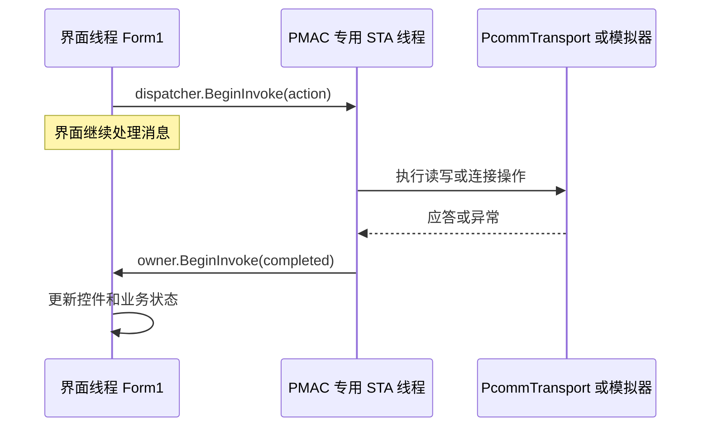
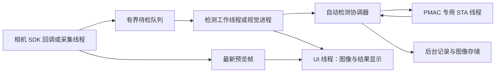

# 当前 C# 代码结构与芯片视觉检测多线程设计说明

本文根据 2026 年 10 月 13 日读取的 `D:/pmac资料/online/Operations Control` 源码编写。工程为 WinForms、.NET Framework 3.5、x86，当前源码目录含 35 个 `.cs` 文件，包括界面设计器、业务代码、自动生成的属性文件和模拟检查程序。

当前已经实现设备连接、点动、定位、反馈显示、命令与程序文件操作、轨迹显示和鼠标双轴目标跟随。相机采集、芯片检测、像素到机械坐标标定和自动检测流程尚未实现。下文中的视觉模块与线程分配属于扩展建议。

**这种结构适合继续扩展视觉功能：界面、数据、通信和设备传输已有基本分工。不过，接入自动检测前，还需要补充业务流程、图像所有权、线程之间的数据交接与设备状态检查。**

## 1. 先理解模块、线程与线程安全的关系

| 概念 | 解决的问题 | 当前工程的例子 |
| --- | --- | --- |
| 模块化 | 一段代码负责什么、依赖谁、如何替换 | `MotionView` 管点动交互，`ControllerSession` 管 PMAC 操作 |
| 多线程 | 哪些工作可以并发执行、耗时工作在哪里执行 | 界面线程与 PMAC 通信线程并发运行 |
| 线程安全 | 多个执行者如何交接和访问数据 | PMAC 操作串行排队，完成结果通过 `BeginInvoke` 交回界面 |
| 流程协调 | 哪一步可以开始、等待什么、何时取消或报错 | 目前以 `Form1` 中的状态标记和事件处理为主 |

一个模块可以完全在界面线程中运行，例如 `ReadoutView`；一个线程也可以执行多个模块，例如 PMAC 通信线程会执行 `ControllerSession` 和 `PcommTransport` 中的工作。增加 `.cs` 文件不会自动创建线程，拆分类也不会自动让类变成线程安全。

后续应先划清职责，再按工作耗时、设备 SDK 要求和并发需要安排线程。无需为每个类创建一个线程。

## 2. 目前的目录与文件职责

```text
Operations Control/
├─ Program.cs                         程序入口
├─ Form1.cs                           主窗体行为与整体协调
├─ Form1.Designer.cs                  主窗体控件与布局
├─ Controls/
│  ├─ AxisReadout.cs                  位置与速度读数控件
│  ├─ AxisReadout.Designer.cs         读数控件布局
│  ├─ MotionCanvas.cs                 曲线与鼠标绘图控件
│  └─ UiTheme.cs                      颜色与按钮状态辅助
├─ Views/
│  ├─ ConnectionView.cs              连接界面行为
│  ├─ ConnectionView.Designer.cs      连接界面布局
│  ├─ ReadoutView.cs                  三行反馈数据显示
│  ├─ ReadoutView.Designer.cs         反馈区布局
│  ├─ MotionView.cs                   点动、定位控件交互
│  ├─ MotionView.Designer.cs          运动区布局
│  ├─ ProgramView.cs                  命令与文件按钮状态
│  ├─ ProgramView.Designer.cs         程序控制区布局
│  ├─ CanvasView.cs                   双画布与坐标参数管理
│  ├─ CanvasView.Designer.cs          双画布区布局
│  ├─ ProgramEditorForm.cs            编辑器窗口行为
│  ├─ ProgramEditorForm.Designer.cs   编辑器窗口布局
│  ├─ LogForm.cs                      日志窗口行为
│  ├─ LogForm.Designer.cs             日志窗口布局
│  ├─ LogView.cs                      日志显示、清空与导出
│  └─ LogView.Designer.cs             日志控件布局
├─ Models/
│  ├─ ControllerModels.cs            应答结果与轴采样数据
│  ├─ CanvasModels.cs                二维坐标、换算与画布事件数据
│  └─ JogRequestEventArgs.cs          点动请求数据
├─ Services/
│  ├─ IControllerTransport.cs        控制器传输接口
│  ├─ PcommTransport.cs              PcommServer COM 适配
│  ├─ SimulatorTransport.cs          8 轴模拟器
│  ├─ ControllerSession.cs           PMAC 专用线程与指令组织
│  └─ CanvasFollower.cs              鼠标跟随目标调度与取消
├─ Properties/
│  ├─ AssemblyInfo.cs                程序集信息
│  ├─ Resources.Designer.cs          自动生成的资源访问类
│  └─ Settings.Designer.cs           自动生成的设置访问类
└─ Tests/
   └─ SmokeTests.cs                   独立模拟检查入口
```

界面对应的 `.resx` 文件保存设计器资源；它们不计入 35 个 C# 文件。`Operations Control.csproj` 决定哪些文件参与编译、设计器文件归属于哪个类，以及目标框架、位数和资源。`Tests/SmokeTests.cs` 由 `build.ps1 -Test` 单独编译成检查程序，不作为主应用入口。

### 2.1 入口与主窗体

| 文件 | 当前职责 | 后续加入视觉时的定位 |
| --- | --- | --- |
| [Program.cs](<D:/pmac资料/online/Operations Control/Program.cs:13>) | `[STAThread]` 入口，启用 WinForms 样式，调用 `Application.Run(new Form1())` | 仍保留为启动入口，可在启动阶段创建应用所需服务 |
| [Form1.cs](<D:/pmac资料/online/Operations Control/Form1.cs:15>) | 创建服务，连接界面事件，协调状态，处理文件流程、停止、断开与关闭 | 逐步收敛为展示与用户操作的入口，把自动检测流程交给独立协调模块 |
| [Form1.Designer.cs](<D:/pmac资料/online/Operations Control/Form1.Designer.cs:13>) | 创建菜单、四分区、双画布、Timer 和对话框，设置布局与样式 | 增加视觉预览区、检测结果区及启动/停止按钮；耗时算法放在服务中 |

`Form1.cs` 中最重要的几个方法：

| 方法 | 含义 |
| --- | --- |
| `WireEvents()` | 把按钮、画布和窗口事件接入整体控制流程 |
| `Run(...)` | 将一项控制器操作排到通信线程；用 `busy` 管理当前操作状态，完成后处理错误和更新界面 |
| `UpdateState()` | 根据连接、忙碌、点动、跟随和关闭状态启用或禁用控件 |
| `RefreshData()` | 提交轴位置查询，收到结果后更新数字读数与实际轨迹 |
| `BeginDrawing()` | 检查连接、轴映射、坐标参数和反馈新鲜度，再开始跟随 |
| `StopJog()` / `StopMonitoredAxes()` | 提交相应轴的停止请求 |
| `Disconnect()` / `CloseForm()` | 结束交互、尝试停止、断开设备，并处理窗口关闭 |
| `OpenProgram()` / `SaveProgram()` / `DownloadProgram()` | 读取、保存、下载程序及检查未保存内容 |

目前 `Form1` 可以承担这些协调工作，因为功能规模仍较小。增加相机、检测配方、自动扫描、多工位结果后，继续把流程塞进这些事件处理函数，会让状态之间的关系难以检查。

### 2.2 Views：标准控件组成的功能区

这些类大部分继承 `UserControl`，两个辅助窗口继承 `Form`。它们的控件操作当前都由界面线程执行。

| 行为文件 | 当前实现 | 对视觉扩展的价值与边界 |
| --- | --- | --- |
| [ConnectionView.cs](<D:/pmac资料/online/Operations Control/Views/ConnectionView.cs:7>) | 提供模拟/实机选择；`ShowState` 显示连接状态与设备名 | 可参照它建立相机连接界面，但相机打开和采集应交给相机服务 |
| [ReadoutView.cs](<D:/pmac资料/online/Operations Control/Views/ReadoutView.cs:7>) | 显示 X、Y 和所选电机；显示采样时间与速度估算说明 | 后续显示采集位姿和检测偏差，但它本身不读取控制器 |
| [MotionView.cs](<D:/pmac资料/online/Operations Control/Views/MotionView.cs:8>) | 管理轴选择、速度、步长及点动按钮按放；发出 `JogStarted`、`JogReleased` | 可继续保留为手动调试区；自动检测运行时需要由流程统一管理手动权限 |
| [ProgramView.cs](<D:/pmac资料/online/Operations Control/Views/ProgramView.cs:6>) | 管理命令输入、文件按钮与下载按钮的启用状态 | 可继续用于调试；自动运动中应避免自由命令与自动指令争用设备 |
| [CanvasView.cs](<D:/pmac资料/online/Operations Control/Views/CanvasView.cs:9>) | 管理范围、ct/mm、模拟/实机模式与两画布状态；发出参数修改事件 | 可显示检测点位；相机标定与机械参数需要移到可独立使用和保存的配置模块 |
| [ProgramEditorForm.cs](<D:/pmac资料/online/Operations Control/Views/ProgramEditorForm.cs:6>) | 发出保存请求；用户关闭时隐藏窗口以保留内容 | 示例说明“窗口提供操作，外部决定文件流程”的做法 |
| [LogView.cs](<D:/pmac资料/online/Operations Control/Views/LogView.cs:8>) | 添加、清空和导出文本日志；最多保留 500 条，达到上限后清空开始下一批 | 适合当前人工操作记录；批量芯片结果需要独立持久化服务，不能仅保留在文本框中 |
| [LogForm.cs](<D:/pmac资料/online/Operations Control/Views/LogForm.cs:5>) | 容纳日志控件；用户关闭时隐藏 | 窗口关闭不会结束后台检测，后台生命周期应由应用或流程协调器控制 |

与上述文件一一对应的设计器文件为：`ConnectionView.Designer.cs`、`ReadoutView.Designer.cs`、`MotionView.Designer.cs`、`ProgramView.Designer.cs`、`CanvasView.Designer.cs`、`ProgramEditorForm.Designer.cs`、`LogView.Designer.cs`、`LogForm.Designer.cs`。

它们负责控件创建、字体、行列布局、Dock、事件绑定和组件释放。`.cs` 与 `.Designer.cs` 中的 `partial class` 在编译后是同一个类，并没有创建第二个对象或第二个线程。布局修改优先通过设计器进行，业务算法写在行为文件或服务中。

`MotionView` 发出点动请求后，`Form1` 才决定是否允许并提交指令。这种事件分工已经降低了点动控件与 PMAC 协议的耦合。其他区域仍公开了不少具体按钮和输入框供 `Form1` 直接访问，属于较轻量的模块化；后续可在功能增长时逐步改为 `StartInspectionRequested` 等语义明确的事件和参数快照。

### 2.3 Controls：可复用的显示与交互控件

| 文件 | 当前实现 | 注意的线程边界 |
| --- | --- | --- |
| [AxisReadout.cs](<D:/pmac资料/online/Operations Control/Controls/AxisReadout.cs:9>) | 将 `AxisSample` 格式化为位置与速度文本；提供设计器可编辑的 `Caption` | `Display`、`Clear` 修改文本框，应在界面线程调用 |
| [AxisReadout.Designer.cs](<D:/pmac资料/online/Operations Control/Controls/AxisReadout.Designer.cs:13>) | 创建标题、数值文本框及单位标签 | 与 `AxisReadout.cs` 合成同一个读数控件 |
| [MotionCanvas.cs](<D:/pmac资料/online/Operations Control/Controls/MotionCanvas.cs:13>) | 双缓冲 GDI+ 绘图、等比例网格、点列、鼠标捕获；发出笔画开始、点更新、结束事件 | `Append` 与 `OnPaint` 使用同一 `List`；当前依靠界面线程独占它，不应从算法线程直接添加轨迹 |
| [UiTheme.cs](<D:/pmac资料/online/Operations Control/Controls/UiTheme.cs:7>) | 提供状态颜色，以及递归绑定按钮禁用颜色的辅助方法 | 当前主窗体使用原生按钮样式，没有调用 `BindButtonStates`；颜色常量仍用于状态反馈 |

`MotionCanvas` 每个实例最多保留约 4000 个点，达到上限后删除最早的一批；这有助于限制显示数据的内存。它适合当前运动轨迹，未来的相机图像显示应使用独立的视觉显示控件，承担图像、缩放、ROI 和缺陷标注，避免把平台轨迹控件扩展成包含所有视觉功能的大类。

### 2.4 Models：模块之间传递的数据

| 文件与类型 | 当前含义 | 后续扩展方向 |
| --- | --- | --- |
| [ControllerModels.cs](<D:/pmac资料/online/Operations Control/Models/ControllerModels.cs:5>)：`CommandResult` | 命令应答文本、状态字；`Validate` 检查通信异常和控制器错误 | 保留原始错误信息，供流程与界面判断 |
| 同文件：`AxisSample` | 电机号、反馈位置、估算速度、采样时间 | 可增加到位、伺服、限位和报警状态；暴露单调时间信息以便流程计算超时 |
| [CanvasModels.cs](<D:/pmac资料/online/Operations Control/Models/CanvasModels.cs:6>)：`MotionPoint` | 二维值类型，保存 X/Y | 当前字段可修改，单位由上下文决定；视觉扩展时建议区分像素点、毫米点和计数目标 |
| 同文件：`CanvasSettings` | 校验行程和正比例；毫米与计数换算；屏幕与物理坐标换算 | 当前为只读字段，可作配置快照；相机标定需额外模型，不宜只用它的两个比例替代 |
| 同文件：`DrawPointEventArgs` | 画布事件传递一个坐标点 | 只传数据，不直接操作控制器 |
| [JogRequestEventArgs.cs](<D:/pmac资料/online/Operations Control/Models/JogRequestEventArgs.cs:5>) | 点动请求中的电机号与方向 | 是按含义传递操作参数的现有例子 |

`AxisSample` 和 `CommandResult` 创建后没有对外开放的修改接口，比较适合跨模块交接。不过 `AxisSample[]` 的数组元素仍可以被替换，未来多个消费者应约定只读使用或使用更明确的快照容器。

`CanvasModels` 同时包含机械换算和 `System.Drawing` 屏幕几何，当前很实用。若以后将视觉服务独立成进程，可把像素、机械坐标和标定参数放在不依赖 WinForms 的数据层，将画布显示映射留在显示层。

### 2.5 Services：设备操作与调度

| 文件 | 当前职责 | 设计评价 |
| --- | --- | --- |
| [IControllerTransport.cs](<D:/pmac资料/online/Operations Control/Services/IControllerTransport.cs:6>) | 定义连接、断开、应答、下载与释放接口 | 实机与模拟可以实现相同约定；接口本身不保证线程安全 |
| [PcommTransport.cs](<D:/pmac资料/online/Operations Control/Services/PcommTransport.cs:13>) | COM 晚绑定；设备选择、打开、`GetResponseEx`、下载与释放 | PMAC SDK 细节集中在这一处；当前设计要求在专用 STA 线程中创建、使用、释放 COM 对象 |
| [SimulatorTransport.cs](<D:/pmac资料/online/Operations Control/Services/SimulatorTransport.cs:12>) | 8 轴位置、速度、点动、目标和 HOMEZ 的内存模拟 | 无需硬件即可验证界面；没有模拟相机、伺服故障、加减速或真实同步触发 |
| [ControllerSession.cs](<D:/pmac资料/online/Operations Control/Services/ControllerSession.cs:11>) | 创建专用 STA 线程，串行执行工作，封装指令和反馈读取 | 是当前并发结构的核心；未来所有 PMAC 操作应继续经过受控入口 |
| [CanvasFollower.cs](<D:/pmac资料/online/Operations Control/Services/CanvasFollower.cs:9>) | 最新鼠标目标替换、最多一个请求在途、配置速度、取消旧目标 | 可借鉴最新数据处理策略和代次标记；不适合直接作为每颗芯片检测任务的可靠队列 |

`ControllerSession` 的设备选择目前直接根据布尔值创建两个具体传输类。后续为测试异常、通信延迟、到位超时，可增加传输工厂或构造参数，注入可控的假设备。没必要在视觉功能尚未确定时建立大量通用框架。

### 2.6 自动生成文件与检查程序

| 文件 | 应如何理解 |
| --- | --- |
| `Properties/AssemblyInfo.cs` | 程序名、版本、COM 可见性等程序集元数据，不处理业务或线程 |
| `Properties/Resources.Designer.cs` | 资源访问代码，应通过资源编辑器和 `.resx` 更新；主窗体图标目前由窗体资源加载 |
| `Properties/Settings.Designer.cs` | 设置访问类；当前尚未定义相机配方或持久化标定设置 |
| [Tests/SmokeTests.cs](<D:/pmac资料/online/Operations Control/Tests/SmokeTests.cs:18>) | 设计宿主加载、模拟协议、坐标换算、交互、目标取消和停止检查；不是应用运行逻辑 |

此前一次构建记录通过了 126 项模拟断言。这个结果覆盖现有功能，并不代表视觉算法、相机 SDK 或实机自动检测已经验证。本次编写说明没有重新运行应用测试。

## 3. 当前线程实际怎样工作

应用自己创建的主要执行线程为：

| 线程 | 执行内容 | 当前不应放入的工作 |
| --- | --- | --- |
| 主界面 STA 线程 | 控件事件、Timer Tick、画布绘制、显示更新、部分文件读写 | 长时间图像计算、同步等待相机、等待平台到位 |
| PMAC 专用 STA 线程 | 连接、指令发送、下载、轴反馈、COM 释放 | 芯片检测算法、图像保存、大量图像预处理 |

CLR、驱动或 SDK 可能还有内部线程，不能把上述表格理解为系统进程一定只有两个线程。

### 3.1 ControllerSession 的两次 BeginInvoke

`ControllerSession` 的构造函数创建一个后台 `Thread`，设置为 STA，在其中创建隐藏的 `Control`，并运行 `Application.Run()` 消息循环。`ManualResetEvent` 用来等待通信线程的分派控件完成初始化。

`Execute(owner, action, completed)` 中的执行路径为：



第一次 `BeginInvoke` 把工作交到通信线程；第二次把完成回调交到拥有 `owner` 控件的界面线程。调用方当前通常传入主窗体。

因为 PMAC 操作都由同一个线程依次执行，通信结果不会被多个控制入口并发读取，COM 对象也保持在同一 STA 中。这比给每个点动、查询、下载操作各开一个线程更容易维护。

但 `Execute` 里的 `action` 会占用这个通信线程，直到整个 `action` 返回。若把耗时 500 ms 的检测算法也放进去，后面的反馈查询和停止请求就要一起等它完成。

### 3.2 两个 WinForms Timer 仍在界面线程

`refreshTimer` 和 `drawTimer` 都是 `System.Windows.Forms.Timer`，Tick 事件由界面消息循环执行。当前设计器没有显式设置 `Interval`，使用该 Timer 的默认值 100 ms。

Timer 触发后提交后台通信工作，Timer 自己没有创建工作线程。界面线程繁忙时，Tick、重绘、鼠标释放事件都会延后；它不是精确的实时调度器。

`pollPending` 防止上一轮位置查询尚未完成时继续提交查询。`CanvasFollower.pending` 限制跟随请求数量；鼠标更新先覆盖 `latest`，由后续 Pump 提交最新目标。这些措施限制了两种常见请求的积压，但通信消息队列本身并没有通用容量或优先级机制。

### 3.3 当前哪些对象只能由某个线程使用

| 对象或字段 | 当前访问约定 | 未来直接跨线程访问的后果 |
| --- | --- | --- |
| WinForms 控件及 `MotionCanvas.points` | 界面线程独占 | 跨线程异常、绘制与添加点冲突 |
| `Form1.busy`、`pollPending`、`currentSamples` 等 | 界面事件和交回界面的回调访问 | 算法线程直接写入会产生状态竞态 |
| `CanvasFollower.latest`、`pending`、`Active` | 主调用在界面线程；通信回调也交回界面 | `Interlocked` 只保护代次标记，不使整个类变成线程安全 |
| `ControllerSession` 的位置缓存和 transport | 实际操作安排在通信线程 | 公共 `Move`、`Send`、`ReadAxes` 方法本身没有自动切线程或统一加锁 |
| `PcommTransport.device` | 专用 STA 线程 | 随意从其他线程调用会破坏当前 COM 使用约定 |

未来算法线程取得结果后，应把结果交给流程协调器，再由协调器安排运动。不要从相机回调直接调用 `session.Move(...)`，也不要直接改 `canvases.ActualCanvas`。

当前 `ControllerSession` 依赖 WinForms `Control` 来交回完成结果；若自动检测流程希望在独立线程中继续执行，需要增加明确的完成结果分派方式或独立业务消息入口。当前接口可用，但不是一个已经与 WinForms 完全解耦的运动服务。

### 3.4 取消操作的实际能力

`CanvasFollower` 用 `generation` 表示本次跟随的代次。取消后递增代次，尚未执行的旧请求发现代次变化就跳过，再排队发送停止请求。这解决了“松开后旧目标又执行”的问题。

如果请求已经进入某个 COM 调用，代次变化不会中断正在执行的调用。当前停止仍经过同一个队列，也没有抢占正在执行的下载或查询。后续自动检测需要区分“已请求取消”“已停止运动”“所有工作已退出”，不能仅修改一个布尔值就认为设备和线程都已停下。

`ControllerSession.Dispose()` 目前提交释放工作后返回，没有等待线程退出的完成通知。对于当前小型窗口程序比较简洁；加入相机和图像缓冲后，应建立可观察的关闭完成流程，保证资源由合适的拥有者释放。

## 4. 两条现有调用链，帮助理解分工

手动点动链路：

```text
MotionView 捕获鼠标/键盘按下
→ JogStarted(电机号、方向)
→ Form1.StartJog 检查状态并读取速度/步长
→ ControllerSession.Execute
→ 通信线程执行 Jog、SetSpeed、Send
→ PcommTransport 或 SimulatorTransport
→ 完成回调交回界面，显示操作结果
```

轨迹与鼠标跟随是两条不同的数据流：

```text
实际轨迹：#nP 反馈 → AxisSample → ReadoutView 与 CanvasView → ActualCanvas
鼠标目标：DrawingCanvas → 毫米点 → CanvasSettings.ToCounts → CanvasFollower → MovePair
```

实际轨迹来源于反馈，而鼠标曲线来源于输入。视觉检测也应保持这种区分：图像中估算的芯片位置、规划的运动目标和平台实际反馈，各有自己的数据及来源。

## 5. 这种模块化方式对视觉项目的优点

| 优点 | 在芯片检测项目中的具体收益 |
| --- | --- |
| UI 与设备细节初步分开 | 修改视觉预览、缺陷列表或统计界面时，可以少改 PMAC 指令 |
| 实机与模拟共用传输接口 | 无控制卡也能验证“点位切换—读取反馈—结果显示”的部分流程；可再增加假相机和离线图像输入 |
| 运动通信有明确入口 | 多个功能的运动请求可以集中管理，便于防止手动点动与自动扫描同时控制平台 |
| 数据以模型交接 | 算法输出可以定义为检测结果，由显示、记录和运动协调分别消费 |
| 现有取消与目标合并有参考价值 | 预览可以仅保留最新帧；取消可用运行代次拒绝过期结果 |
| Designer 与行为文件分开 | 工具箱布局和算法开发可以各自维护，仍保留可视化编辑体验 |
| 局部功能可单独验证 | 先用图片验证算法，先用模拟器验证流程，再联机验证采集与运动时序 |

模块化更直接的收益是维护与测试能力。运行速度的提升来自合理并发、合适的算法、图像分辨率与硬件；仅把大文件拆成小文件，通常不会让检测计算本身更快。

## 6. 当前结构的局限，以及何时需要调整

| 当前情况 | 加入视觉后的影响 | 建议调整 |
| --- | --- | --- |
| `Form1` 承担多种业务协调和文件操作 | 自动扫描、检测、复检等状态会挤进按钮事件，容易形成相互依赖 | 提取 `InspectionCoordinator`；文件持久化按数据量增加独立服务 |
| 多个 View 公开具体控件 | 算法或流程容易依赖窗体布局，也不利于无界面检查 | 对新模块使用语义事件、配置快照与显示方法 |
| Canvas 参数与标定就绪状态存于 UI | 自动流程无法在无窗口时可靠使用和保存参数 | 提取轴配置、机械换算和标定模型；UI 负责编辑与显示 |
| `HardwareCalibrated` 在合法输入应用后置真 | 它实际表示参数已应用，没有验证机械或相机标定精度 | 后续区分参数应用状态、真实标定结果、标定版本与误差 |
| Services 中仍使用 WinForms 控件交回结果 | 新后台流程容易被界面生命周期与刷新速度影响 | 增加明确业务结果入口，逐步把运动接口与 UI 分派解开 |
| `busy` 等标记针对手动功能 | 自动检测不能简单长期置 `busy=true`，因为当前位置轮询也会停 | 自动流程使用独立状态机，反馈监测持续运行；分别管理操作权限 |
| 普通消息队列串行处理 | 长时间下载、读写或错误超时会延迟后面的停止与反馈 | 限制自动运行中可执行操作；设置通信超时策略，必要时增加请求调度与超时恢复 |
| `Move` / `MovePair` 完成代表指令执行返回 | 返回成功不等于平台已到位；立即拍照可能得到模糊或错误点位图像 | 增加到位检查、稳定等待、报警检查与超时处理 |
| X/Y 反馈逐轴查询 | 两个位置并非同一曝光时刻的同步快照 | 初期采用停稳后拍照；连续扫描时再接入硬件触发、时间戳或位置锁存 |
| 读取/保存文件与日志导出在 UI 线程 | 大量原图、结果或数据库写入会拖慢界面与交互停止 | 后台存储工作、有界队列、批次数据与失败处理 |
| 日志主要存文本框，超过 500 条清空 | 不能承担每颗芯片的完整追溯 | 独立记录批次、芯片 ID、图像关联、配方与检测结果 |
| .NET 3.5 + x86 | 现代视觉库与推理运行时的兼容选择受限，图像内存更紧张 | 在确定 SDK 后决定兼容升级或独立 64 位视觉进程 |

目前依次发送两个轴的 `J=` 目标，不提供两轴同步轨迹或控制器插补。它可用于双轴目标跟随的演示与调试，自动检测必须按真实 PMAC 配置选择定位、到位和触发方法。

### 6.1 模块化本身也有维护成本

| 成本 | 在当前项目中的表现 | 控制方式 |
| --- | --- | --- |
| 文件与调用链增加 | 一个定位操作要经过 View、Form1、Session 和 Transport，初学时要跳转多个文件 | 保留清晰命名、调用链说明和按模块组织的目录 |
| 接口变更会影响上下游 | 增加缺陷尺寸、标定版本或异常类型，需要同步调整算法结果、显示与存储 | 提前约定结果格式；以任务快照交接数据，减少到处共享变量 |
| 过度拆分会增加理解难度 | 每个按钮、每种小计算都单独建立服务，可能只有文件数量增加 | 按稳定职责与设备边界拆分，小逻辑留在所属模块中 |
| 异步执行让故障追踪更复杂 | 出错位置、提交位置和显示错误的位置可能处于不同模块与线程 | 日志带 RunId、TaskId、FrameId，并记录状态变化和执行耗时 |
| 数据跨模块可能带来复制与排队成本 | 图像在采集、检测、预览和存储之间反复复制会消耗内存和带宽 | 明确图像所有权；仅在需要时复制，给队列设容量 |
| 测试需要覆盖组合行为 | 各模块单独正确，仍可能出现未到位拍照、旧结果驱动新任务等错误 | 同时检查算法单元、设备适配和端到端流程时序 |

这些成本并不意味着要把所有功能重新放回一个窗体。应让模块边界对应真实职责，保持调用方向清楚，并根据项目规模逐步增加抽象。

## 7. 建议增加的视觉模块

以下名称是建议，当前工程中还没有这些文件。

| 建议模块 | 主要职责 | 推荐交接数据 |
| --- | --- | --- |
| `ICameraSource` | 定义相机连接、配置、采集与触发能力，供真实相机和离线输入实现 | 相机状态、帧数据、异常 |
| `CameraService` | 封装相机 SDK；处理驱动回调、缓冲所有权与停止 | 带 FrameId、采集元数据的 FramePacket |
| `IChipDetector` / `ChipDetector` | 预处理、定位、检测缺陷、测量或模型推理 | InspectionResult |
| `VisionCalibration` / `CalibrationService` | 镜头校正、像素到毫米、相机到平台坐标变换 | 标定参数、版本、误差范围、转换结果 |
| `InspectionCoordinator` | 点位序列、移动、等待、触发、检测、记录与取消 | 自动运行状态、结构化设备请求与结果 |
| `InspectionStore` | 图像与结果存储、文件命名、批次追溯 | 已关联的图像与检测记录 |
| `VisionView` | 原图与标注显示、ROI 编辑、参数输入、检测统计 | 接收预览与结果，发出操作请求 |
| `FakeCameraSource` / 离线图片输入 | 无相机测试采集流程与算法 | 可重复的图片与触发响应 |

算法模块应能接受一张图与一个配方，返回结果；无需知道按钮、窗体或 `PcommTransport`。传统算法与深度学习算法可以使用同一检测接口，避免更换算法时重写运动流程。

`InspectionResult` 建议包含芯片 ID、任务 ID、FrameId、OK/NG/异常状态、缺陷类别与位置、测量值及单位、耗时、配方版本和标定版本。模型置信度可以按算法能力记录；通信失败、无有效图像与算法异常应保留为独立状态，不能合并为合格。

## 8. 芯片检测时怎样分配线程

### 8.1 从四种执行职责开始

| 执行职责 | 常见安排 | 约束 |
| --- | --- | --- |
| 界面与绘制 | 保留主 UI 线程 | 只显示最新预览、结果和操作状态，少做耗时工作 |
| PMAC 设备操作 | 保留现有专用 STA 线程 | 控制器操作集中串行；只执行通信及必要短操作 |
| 相机采集 | 使用 SDK 的帧回调，或按 SDK 要求使用采集线程 | SDK 回调中尽快交接缓冲，不执行整个检测算法或文件写入 |
| 图像处理/检测 | 初期一个检测工作线程或独立视觉进程 | 统一管理检测器实例和图像所有权；根据测量决定是否加并行 |

流程协调可使用独立的串行执行上下文，按事件推进状态，不必每个状态开线程。图像存储在有持续写盘需求时增加独立工作通道。

一次手动拍照、耗时很短的简单检测，可以先通过一个后台工作入口实现。持续采集、高分辨率计算以及运动期间保持反馈，则需要更明确的采集与处理流水线。



图表示可采用的扩展数据流。相机和 PMAC 工作方式仍需服从实际 SDK、触发电路和机械时序。

### 8.2 预览与正式检测采用不同队列策略

| 数据用途 | 建议策略 | 队列满时的处理 |
| --- | --- | --- |
| 实时预览 | 一个最新帧位置，允许替换旧帧 | 释放旧帧，只显示最近图像 |
| 连续视觉目标跟踪 | 可以合并旧位置，但检查图像年龄、任务代次与反馈 | 拒绝过期结果，防止平台追逐旧目标 |
| 每颗芯片的正式检测 | 有界任务队列，每个任务都有身份和完成状态 | 控制新触发、降低采集速度或停线报错，不静默丢失待检芯片 |
| 图像与检测记录存储 | 有界写入队列，按追溯要求决定优先级 | 执行预先约定的限流、暂停或存储故障策略 |

鼠标跟随中的“只要最新位置”适合实时交互。若把这一策略直接套到芯片检测，就可能把前一颗未处理的芯片覆盖掉。预览丢一帧与正式检测漏一颗芯片，业务意义不同。

示例：相机产生 30 帧/秒，单个检测任务耗时 80 ms，则一个检测工作者理想吞吐约为 12.5 帧/秒，忽略其他开销时每秒也会积压约 17.5 帧。增加队列只会推迟队列满的时间；要通过降触发率、减小 ROI、优化算法、合适的硬件或经验证的并行来提高吞吐。

增加检测线程后，底层 OpenCV、模型运行时或 GPU 也可能内部并行。多个线程同时争用同一个推理实例不一定安全，也不一定更快。先测采集等待、预处理、推理、显示与写盘耗时，再决定是否使用多个工作者和独立算法实例。

## 9. 图像对象和结果如何安全交接

### 9.1 一张图片有明确拥有者

工业相机可能重复使用 SDK 缓冲区；SDK 回调返回后，原缓冲不一定还能由检测线程使用。应按相机 SDK 的约定，复制数据或显式取得缓冲保留权，然后再放入队列。

建议的规则是：

1. 采集模块交接后，明确由检测任务拥有该帧或一个合法引用。
2. 检测与预览并行读取时，使用独立图像、副本或受控引用；任何一方都不能擅自释放另一方正在使用的内存。
3. 结果优先交接数值、框、类别与版本等只读数据。
4. 图像不再被任何消费者使用时，才释放 SDK 缓冲、Bitmap、Mat 或其他本机内存。
5. 预览替换图像时，在 UI 线程交换并释放已不再使用的旧显示图像，避免绘制期间释放。

例如 2048 × 2048 的 8 位三通道原图约占 12 MiB，仅缓存 30 张就是约 360 MiB，尚未计入预览副本、转换中间图像、模型和本机分配。当前 x86 进程可用地址空间受系统及程序配置限制，多份图像副本和碎片化会显著压缩余量，因此队列容量和资源释放必须设计清楚。

### 9.2 事件触发不会自动切换线程

普通 C# 事件在发出它的线程上执行订阅处理函数。相机在 SDK 线程发出 `FrameReceived`，订阅函数通常也在那个 SDK 线程执行，除非显式分派。

界面更新可使用 `BeginInvoke`，但不要在每帧都无上限地排队。预览可以定期取最新帧，检测结果则按任务交付。`LogView.Append`、`ReadoutView.Display`、`MotionCanvas.Append` 都修改界面或界面拥有的数据，应经过 UI 分派。

界面异步回调还应考虑关闭：控件已经销毁时应放弃显示回调，并释放该回调携带的资源。取消业务任务与取消显示回调是两个需要协调的生命周期。

### 9.3 结果关联比加锁更重要

每个帧和检测任务建议携带：`RunId`、`TaskId`、`ChipId`、`FrameId`、触发标识、采集/曝光时间、坐标系和采集位姿、配方版本、标定版本。

算法处理 B 芯片时，平台可能已经移动到 C 芯片。若此时只读取“最新平台位置”，就会把 B 的检测结果关联到 C 的位置。应使用与 B 曝光关联的位姿或点位信息；处理速度越慢，越需要保留这种关联。

相机时间戳可能来自设备时钟，`AxisSample.Timestamp` 当前来自上位机时间，二者不能直接相减来判断曝光同步。停稳后触发可以简化初期时序；连续扫描时需建立时间基准、触发编号或硬件锁存关系。

## 10. 推荐先实现停稳拍照的自动流程

初期可把检测过程组织为显式状态：

```text
空闲
→ 验证配方、标定、相机与设备状态
→ 提交点位移动
→ 等待两轴到位与稳定
→ 触发拍照并等待对应帧
→ 检测
→ 保存图像关联与结果
→ 下一点 / 完成
```

各状态都有超时和失败转移；取消从任何状态都能转入停止处理，记录未完成任务，并等待所需资源退出。等待通过后台流程或状态事件实现，不在界面线程 `Thread.Sleep` 或轮询等待。

“命令已接受”只说明通信层完成，不能作为拍照条件。需要按真实 PMAC 配置读取到位与报警状态，并在必要时结合允许位置误差、速度或稳定时间。具体位号和判定阈值应依据设备配置确定，目前代码没有这些信息。

若初期只能拿到位置反馈，允许用带超时的位置容差与稳定样本作为调试方案，但应明确它不能完整替代控制器的伺服到位、限位和报警状态。

自动检测、手动点动和鼠标跟随需要运动操作权：运行自动检测时，由协调器统一允许或拒绝手动移动，只有获准的流程才能发运动请求。仅依赖控件灰显不足以约束后台请求。这个操作权可通过流程状态和命令入口校验实现，不应使用一个长时间持有的大锁覆盖拍照、推理和磁盘写入。

还要区分已有的鼠标交互失焦停止与自动运行策略。当前 `Form1.Deactivate` 会停止点动和鼠标跟随；未来打开日志窗口是否暂停自动检测，应在自动流程中明确规定，不应让它无意中继承所有手动事件行为。

## 11. 视觉像素与平台毫米不是同一种标定

当前 `CanvasSettings` 的换算为：

```text
平台毫米 = 电机反馈计数 / 对应轴 ct/mm
```

它只处理平台反馈计数与毫米，没有建立相机图像坐标和机械坐标之间的关系。`HardwareCalibrated` 当前也是参数应用状态，不是一次自动测量得到的相机标定结果。

视觉定位需要额外确定像素方向、比例、旋转、坐标零点以及必要的镜头畸变和透视关系。对适用的平面，可以采用标定得到的仿射或平面映射；是否适用还取决于镜头、工件平面与安装方式。

相机固定与相机随平台移动时，位置补偿的方向和位姿关系不同。一般处理链为：

```text
芯片在图像中的像素位置或偏差
→ 按相机标定转换为物理偏差
→ 结合曝光位姿与相机/工件坐标关系，得到平台目标
→ 应用轴 ct/mm 和合法行程检查
→ 提交平台运动
```

检测配方和标定参数应按版本形成快照。一次检测任务从开始到结束使用相同配方与标定版本，防止操作员中途修改数值造成同批结果混用。

## 12. .NET 3.5、x86 与未来视觉库的选择

当前 .NET Framework 3.5 自带 `Thread`、`ThreadPool`、`BackgroundWorker`、`Monitor`、`ManualResetEvent`、`AutoResetEvent` 等工具，可以实现有界队列与后台流水线。

它不提供现代 .NET 的 `Task.Run`、`ConcurrentQueue`、`BlockingCollection`、`CancellationToken` 或 Channels 等内置 API。现成的 `async/await` 示例通常也假定更新的运行库支持；不能把这些示例直接当作当前项目可编译的实现。

| 路线 | 优点 | 代价与适用条件 |
| --- | --- | --- |
| 保持 .NET 3.5 + x86 | 最大限度保留当前 PMAC 集成方式 | 必须选择兼容的相机与视觉库；手工管理线程与有界队列；内存余量较小 |
| 主程序升级到经 SDK 验证的 .NET Framework 版本，先保留 x86 | 可使用较成熟的任务、取消与队列 API，维护成本下降 | 仍受 x86 与本机 DLL 位数限制；必须验证相机 SDK、COM、驱动与视觉库 |
| 保留运动上位机，增加独立 64 位视觉进程 | PMAC 32 位兼容与现代视觉运行时、较大图像内存可以各自满足 | 增加进程协议、超时、版本与部署管理；传大量图像需要评估复制成本 |

位数约束主要来自进程内的 COM/本机依赖；独立进程可以采用不同位数。不能仅把项目切为 x64 就认为现有 32 位 PcommServer 和相机库都可继续加载，也不能保证升级 .NET 就能兼容任意新视觉库。

独立视觉进程可用命名管道、TCP 或经过设计的共享内存交接任务与结果。初期优先考虑数据量小、容易追踪的任务与结果协议；高帧率大图像传输再评估共享内存和缓冲生命周期。

## 13. 按什么顺序扩展最合适

1. 确认相机型号、SDK、曝光/触发方式、分辨率、目标检测节拍和检测内容。判断只需缺陷判定，还是还要定位后移动平台。
2. 先用离线图片实现 `IChipDetector`，明确输入格式、ROI、预处理与输出数据；让算法可在没有窗体和控制卡的情况下运行。
3. 加入相机适配与预览，验证帧格式、缓冲所有权、队列容量和关闭过程，再把算法接入后台处理。
4. 增加真实平台配置、到位与报警读取、相机标定，把“参数已填写”和“设备已经验证”分开。
5. 提取 `InspectionCoordinator`，先做停稳拍照、单点检测，然后扫描多个芯片点位；通过统一入口管理运动权限。
6. 增加批次、芯片 ID、帧关联和结果存储。验证取消、重连、漏触发、错误帧和过期结果处理。
7. 测量吞吐与最长响应时间，再决定是否采用多检测线程、GPU、流水线重叠或独立视觉进程。

适合新增的检查包括：相机缓冲被复用时图像是否仍正确、预览替换是否释放旧图像、正式任务是否丢失、结果是否关联正确芯片、未到位是否禁止触发、取消后过期结果是否被拒绝、通信或相机失败是否正确结束任务、关闭时是否仍有线程访问已释放资源。

当前代码可以继续作为项目基础。最有价值的下一步是明确设备入口、自动流程和数据归属，再增加相机与检测模块；线程数量应随实际流水线需要调整。
